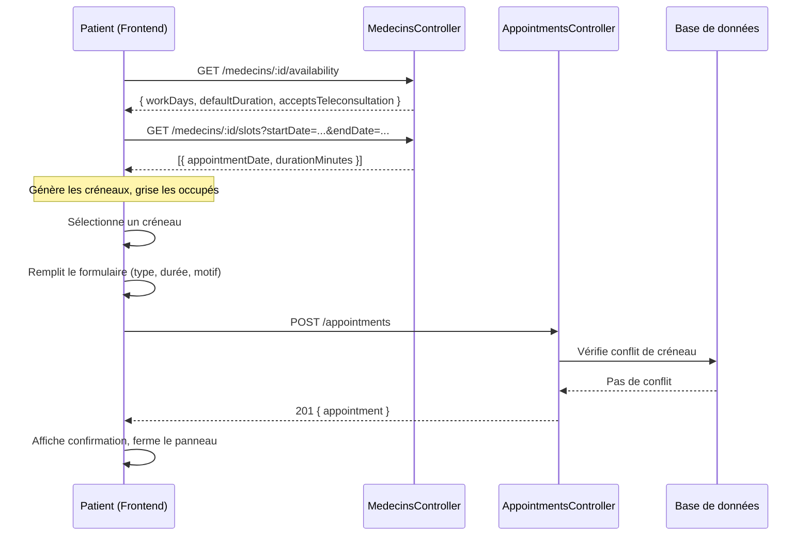

# Document de Design Technique
# Prise de rendez-vous depuis la recherche de médecins

## Vue d'ensemble

Cette fonctionnalité permet à un patient authentifié de prendre rendez-vous avec un médecin directement depuis la page "Trouver un Médecin". Le flux complet se déroule sans changer de page : un panneau latéral (ou modal) s'ouvre avec un calendrier hebdomadaire, le patient sélectionne un créneau, renseigne les informations de consultation, puis confirme.

Le backend NestJS existant est étendu avec deux nouveaux endpoints :
- `GET /medecins/:id/availability` — disponibilités du médecin (workDays, defaultDuration, acceptsTeleconsultation)
- `GET /medecins/:id/slots` — créneaux occupés pour une plage de dates

La création du rendez-vous utilise l'endpoint existant `POST /appointments`.

---

## Architecture

### Vue d'ensemble des composants

```mermaid
graph TD
    A[Page Recherche Médecins] -->|clic "Prendre RDV"| B[Panneau RDV]
    B -->|GET /medecins/:id/availability| C[MedecinsController]
    B -->|GET /medecins/:id/slots| C
    B -->|POST /appointments| D[AppointmentsController]
    C --> E[MedecinsService]
    D --> F[AppointmentsService]
    E --> G[(DB: medecin_profiles)]
    F --> H[(DB: appointments)]
```

### Flux de prise de rendez-vous



---

## Composants et Interfaces

### Backend — Nouveaux endpoints

#### `GET /medecins/:id/availability`

Retourne les disponibilités configurées d'un médecin identifié par son `userId`.

**Paramètre de route :** `id` (UUID du médecin / userId)

**Réponse 200 :**
```json
{
  "workDays": [
    { "day": "monday", "startTime": "09:00", "endTime": "17:00" }
  ],
  "defaultDuration": 30,
  "acceptsTeleconsultation": true,
  "disponTeleconsult": true
}
```

**Réponse 404 :** si le médecin n'existe pas.

#### `GET /medecins/:id/slots`

Retourne les créneaux occupés (CONFIRMED ou REQUESTED) pour une plage de dates.

**Paramètres de route :** `id` (UUID du médecin)

**Paramètres de requête :**
- `startDate` : date ISO 8601 (ex. `2025-01-20`)
- `endDate` : date ISO 8601 (ex. `2025-01-26`)

**Réponse 200 :**
```json
[
  {
    "appointmentDate": "2025-01-20T09:00:00.000Z",
    "durationMinutes": 30
  }
]
```

**Réponse 404 :** si le médecin n'existe pas.

### Backend — Endpoint existant utilisé

#### `POST /appointments`

Crée un rendez-vous avec le statut `REQUESTED`. Vérifie l'absence de conflit de créneau avant création.

**Corps de la requête :**
```json
{
  "patientId": "uuid-patient",
  "doctorId": "uuid-medecin",
  "appointmentDate": "2025-01-20T09:00:00.000Z",
  "durationMinutes": 30,
  "consultationType": "PHYSICAL",
  "reason": "Consultation de routine"
}
```

### Frontend — Composants Angular

| Composant | Responsabilité |
|---|---|
| `BookAppointmentPanelComponent` | Conteneur principal (panneau/modal), gère l'état global du flux via `BookingStateService` |
| `WeeklyCalendarComponent` | Affiche les 7 jours, génère et affiche les créneaux, navigation semaine |
| `TimeSlotComponent` | Créneau individuel (disponible / occupé / sélectionné), émet un `EventEmitter` au clic |
| `AppointmentFormComponent` | Formulaire type/durée/motif (Reactive Forms) + récapitulatif |
| `AppointmentSummaryComponent` | Récapitulatif avant confirmation |

### Services Angular

| Service | Responsabilité |
|---|---|
| `MedecinAvailabilityService` | Appelle `GET /medecins/:id/availability` via `HttpClient` |
| `MedecinSlotsService` | Appelle `GET /medecins/:id/slots` via `HttpClient` |
| `AppointmentBookingService` | Appelle `POST /appointments` via `HttpClient`, gère loading/erreur |
| `BookingStateService` | Service d'état partagé (créneau sélectionné, semaine courante, formulaire) |

### Modèle d'état Angular (BookingStateService)

```typescript
// Signal-based state (Angular 17+) ou BehaviorSubject (Angular < 17)
interface BookingState {
  doctorId: string;
  selectedSlot: Date | null;
  consultationType: 'PHYSICAL' | 'TELECONSULTATION';
  durationMinutes: number;
  reason: string;
  currentWeekStart: Date;
  isLoading: boolean;
  error: string | null;
}
```

---

## Modèles de données

### Disponibilité du médecin (stockée dans `medecin_profiles.tarifs` en JSONB)

```typescript
interface WorkDay {
  day: 'monday' | 'tuesday' | 'wednesday' | 'thursday' | 'friday' | 'saturday' | 'sunday';
  startTime: string; // "HH:mm"
  endTime: string;   // "HH:mm"
}

interface AvailabilityConfig {
  workDays: WorkDay[];
  defaultDuration: number;          // minutes (15, 30, 45, 60)
  acceptsTeleconsultation: boolean;
}
```

### DTO — Slots occupés (nouveau)

```typescript
// GET /medecins/:id/slots — query params
interface GetSlotsQuery {
  startDate: string; // ISO date "YYYY-MM-DD"
  endDate: string;   // ISO date "YYYY-MM-DD"
}

// Réponse
interface OccupiedSlot {
  appointmentDate: string; // ISO datetime
  durationMinutes: number;
}
```

### État frontend du panneau de réservation

Géré par `BookingStateService` (voir section composants Angular ci-dessus).

### Logique de génération des créneaux (frontend)

À partir des `workDays` et `defaultDuration`, le frontend génère tous les créneaux théoriques de la semaine affichée, puis soustrait les créneaux occupés retournés par `GET /medecins/:id/slots`.

```
créneaux_disponibles = créneaux_théoriques(workDays, defaultDuration, semaine)
                       \ créneaux_occupés(slots)
```

Un créneau théorique `[start, start + duration[` est considéré occupé si un slot existant `[slotStart, slotStart + slotDuration[` chevauche cet intervalle.

---

## Propriétés de Correction

*Une propriété est une caractéristique ou un comportement qui doit être vrai pour toutes les exécutions valides d'un système — c'est-à-dire une déclaration formelle de ce que le système doit faire. Les propriétés servent de pont entre les spécifications lisibles par l'humain et les garanties de correction vérifiables automatiquement.*

### Propriété 1 : Calendrier affiche exactement 7 jours consécutifs

*Pour toute* date de départ, la fonction de génération du calendrier hebdomadaire doit retourner exactement 7 dates consécutives, la première étant la date de départ.

**Valide : Exigences 2.1**

---

### Propriété 2 : Créneaux générés respectent les workDays et defaultDuration

*Pour toute* configuration de disponibilité (workDays, defaultDuration) et toute semaine affichée, chaque créneau généré doit : (a) tomber dans un jour de travail configuré, (b) avoir une heure de début dans la plage [startTime, endTime] du jour, (c) avoir une durée égale à defaultDuration.

**Valide : Exigences 2.2**

---

### Propriété 3 : Absence de chevauchement — créneaux occupés exclus et création rejetée

*Pour tout* médecin et toute liste de créneaux occupés retournée par `GET /medecins/:id/slots`, aucun créneau disponible affiché ne doit chevaucher un créneau occupé. De plus, toute tentative de création d'un rendez-vous via `POST /appointments` sur un créneau déjà occupé (CONFIRMED ou REQUESTED) doit être rejetée avec HTTP 400.

**Valide : Exigences 2.3, 5.4, 7.1**

---

### Propriété 4 : Sélection unique d'un créneau

*Pour toute* séquence de sélections de créneaux, l'état du panneau de réservation ne doit contenir qu'un seul créneau sélectionné à la fois — le dernier créneau cliqué.

**Valide : Exigences 3.2, 3.3**

---

### Propriété 5 : Téléconsultation désactivée si non acceptée

*Pour tout* médecin dont la disponibilité a `acceptsTeleconsultation = false`, l'option "Téléconsultation" dans le formulaire doit être désactivée (non sélectionnable).

**Valide : Exigences 4.2**

---

### Propriété 6 : Durée pré-remplie avec defaultDuration

*Pour tout* médecin avec un `defaultDuration` configuré, à l'ouverture du formulaire de confirmation, le champ "Durée" doit être initialisé à la valeur `defaultDuration` du médecin.

**Valide : Exigences 4.3**

---

### Propriété 7 : Motif limité à 500 caractères

*Pour toute* chaîne de caractères de longueur supérieure à 500, la saisie dans le champ "Motif" doit être rejetée ou tronquée à 500 caractères maximum.

**Valide : Exigences 4.4**

---

### Propriété 8 : Récapitulatif contient toutes les informations requises

*Pour tout* état de formulaire valide (créneau sélectionné, type et durée choisis), le composant récapitulatif doit afficher : le nom complet du médecin, la date et l'heure du créneau, le type de consultation et la durée.

**Valide : Exigences 4.5**

---

### Propriété 9 : Statut initial REQUESTED à la création

*Pour tout* rendez-vous créé avec succès via `POST /appointments`, le statut retourné dans la réponse doit être `REQUESTED`.

**Valide : Exigences 5.1**

---

### Propriété 10 : Structure complète de la réponse GET /availability

*Pour tout* médecin existant, `GET /medecins/:id/availability` doit retourner un objet contenant les champs `workDays`, `defaultDuration`, `acceptsTeleconsultation` et `disponTeleconsult`.

**Valide : Exigences 6.1**

---

### Propriété 11 : Slots occupés = rendez-vous CONFIRMED/REQUESTED dans la plage

*Pour tout* médecin et toute plage de dates [startDate, endDate], les créneaux retournés par `GET /medecins/:id/slots` doivent correspondre exactement à l'ensemble des rendez-vous de ce médecin avec le statut `CONFIRMED` ou `REQUESTED` dont la date tombe dans la plage demandée.

**Valide : Exigences 6.3, 6.4**

---

### Propriété 12 : Round-trip création → lecture des slots

*Pour tout* rendez-vous créé avec succès via `POST /appointments`, un appel ultérieur à `GET /medecins/:id/slots` couvrant la date de ce rendez-vous doit inclure ce rendez-vous dans les créneaux occupés retournés.

**Valide : Exigences 7.2**

---

### Propriété 13 : Idempotence — double réservation rejetée

*Pour tout* appel à `POST /appointments` avec les mêmes `doctorId`, `appointmentDate` et `durationMinutes` qu'un rendez-vous existant (CONFIRMED ou REQUESTED), le second appel doit être rejeté avec HTTP 400.

**Valide : Exigences 7.3**

---

## Gestion des erreurs

### Erreurs backend

| Situation | Code HTTP | Message |
|---|---|---|
| Médecin introuvable (`GET /availability`, `GET /slots`) | 404 | "Médecin non trouvé" |
| Créneau déjà réservé (`POST /appointments`) | 400 | "Ce créneau est déjà réservé pour ce médecin." |
| Paramètres manquants (`startDate`/`endDate`) | 400 | "Les paramètres startDate et endDate sont requis." |
| Token JWT absent ou invalide | 401 | "Unauthorized" |

### Erreurs frontend

| Situation | Comportement |
|---|---|
| Patient non authentifié | Redirection vers `/login` avec `returnUrl` |
| Erreur chargement disponibilités | Message d'erreur dans le panneau, bouton "Réessayer" |
| Créneau devenu indisponible à la confirmation | Message d'erreur, calendrier rechargé, formulaire conservé |
| Erreur réseau à la confirmation | Message d'erreur, données du formulaire conservées, bouton réactivé |
| Médecin sans disponibilités configurées | Message "Aucun créneau disponible pour ce médecin." |

---

## Stratégie de tests

### Approche duale : tests unitaires + tests basés sur les propriétés

Les deux types de tests sont complémentaires et tous deux nécessaires :
- **Tests unitaires** : vérifient des exemples concrets, des cas limites et des conditions d'erreur
- **Tests de propriétés** : vérifient des propriétés universelles sur un grand nombre d'entrées générées aléatoirement

### Tests unitaires (exemples et cas limites)

**Backend :**
- `GET /medecins/:id/availability` retourne 404 pour un ID inexistant
- `GET /medecins/:id/slots` retourne une liste vide si aucun RDV dans la plage
- `POST /appointments` retourne 400 si le créneau est occupé
- `POST /appointments` crée un RDV avec statut REQUESTED
- Navigation semaine : impossible de reculer avant la date du jour

**Frontend :**
- Ouverture du panneau au clic sur "Prendre RDV"
- Redirection vers login si non authentifié
- Affichage du message "Aucun créneau disponible" si workDays vide
- Désactivation du bouton "Confirmer" sans créneau sélectionné
- Affichage de l'indicateur de chargement pendant la requête

### Tests de propriétés (property-based testing)

**Bibliothèque recommandée :**
- Backend (NestJS/TypeScript) : **fast-check**
- Frontend (Angular/TypeScript) : **fast-check** avec **Jest** ou **Karma/Jasmine**

**Configuration :** minimum 100 itérations par test de propriété.

**Format de tag :** `Feature: book-appointment-from-search, Property {N}: {texte}`

Chaque propriété de correction doit être implémentée par un unique test de propriété :

| Propriété | Test de propriété |
|---|---|
| P1 — 7 jours consécutifs | Générer des dates aléatoires, vérifier que `generateWeekDays(date)` retourne 7 dates consécutives |
| P2 — Créneaux respectent workDays/defaultDuration | Générer des configs aléatoires, vérifier que tous les créneaux générés respectent les contraintes |
| P3 — Absence de chevauchement | Générer des slots occupés aléatoires, vérifier qu'aucun créneau disponible ne chevauche un slot occupé ; tenter POST sur un slot occupé → 400 |
| P4 — Sélection unique | Générer des séquences de sélections aléatoires, vérifier que `selectedSlot` ne contient qu'un seul créneau |
| P5 — Téléconsultation désactivée | Générer des médecins avec `acceptsTeleconsultation=false`, vérifier que l'option est désactivée |
| P6 — Durée pré-remplie | Générer des `defaultDuration` aléatoires, vérifier l'initialisation du formulaire |
| P7 — Motif ≤ 500 caractères | Générer des chaînes de longueur > 500, vérifier le rejet/troncature |
| P8 — Récapitulatif complet | Générer des états de formulaire aléatoires, vérifier que le rendu contient tous les champs |
| P9 — Statut REQUESTED | Générer des DTOs valides aléatoires, vérifier que le statut retourné est REQUESTED |
| P10 — Structure GET /availability | Générer des profils médecin aléatoires, vérifier la présence de tous les champs |
| P11 — Slots = RDV CONFIRMED/REQUESTED | Générer des RDV aléatoires, vérifier la correspondance exacte avec les slots retournés |
| P12 — Round-trip création → slots | Créer un RDV, vérifier qu'il apparaît dans GET /slots |
| P13 — Idempotence double réservation | Créer un RDV, tenter de créer le même → vérifier HTTP 400 |
