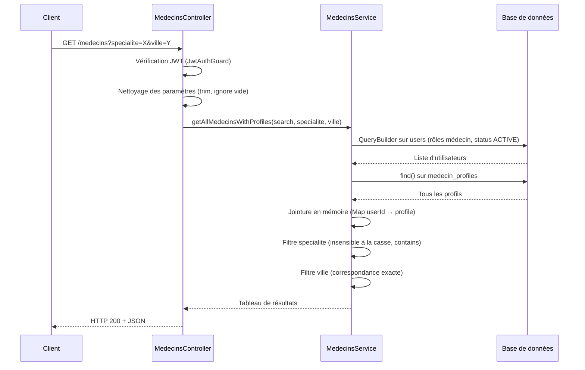
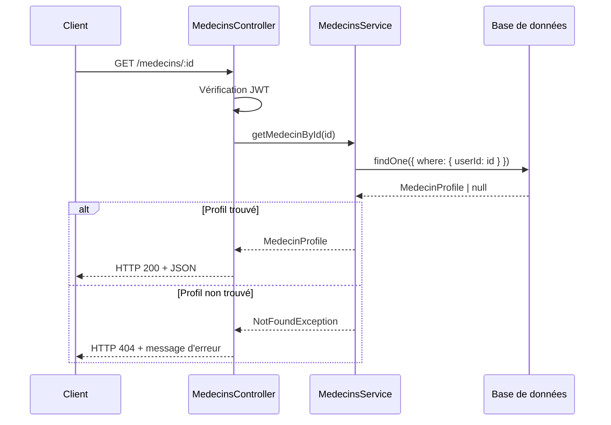

# Document de Design Technique — Recherche de Médecins

## Vue d'ensemble

La fonctionnalité de recherche de médecins permet à tout utilisateur authentifié d'interroger l'endpoint `GET /medecins` pour obtenir la liste des médecins actifs, filtrée optionnellement par spécialité, ville et/ou terme de recherche libre. Un endpoint `GET /medecins/:id` permet d'accéder au profil détaillé d'un médecin.

Le backend NestJS dispose déjà de l'infrastructure de base (contrôleur, service, entités). Ce design formalise le comportement attendu, identifie les lacunes à combler et définit les propriétés de correction à valider.

---

## Architecture

Le module `medecins` suit l'architecture en couches standard de NestJS :

```
Client HTTP
    │
    ▼
MedecinsController  (routing, validation des query params, garde JWT)
    │
    ▼
MedecinsService     (logique métier, filtres, assemblage des résultats)
    │
    ▼
TypeORM Repositories
    ├── UserRepository       (table `users`)
    └── MedecinProfileRepository  (table `medecin_profiles`)
```

### Flux de recherche



### Flux profil détaillé



---

## Composants et Interfaces

### MedecinsController

Responsable du routage HTTP, de la validation des paramètres d'entrée et de la protection par JWT.

**Modifications requises :**

1. `GET /medecins` — nettoyer les paramètres (trim, ignorer les chaînes vides) avant de les transmettre au service.
2. `GET /medecins/:id` — retourner HTTP 404 si le médecin n'existe pas ou n'est pas actif (actuellement, `getProfile` crée un profil vide si absent — comportement incorrect pour cet endpoint public).

**Interface des query params :**

```typescript
// DTO de recherche (à créer)
export class SearchMedecinsDto {
  @IsOptional()
  @IsString()
  @Transform(({ value }) => value?.trim())
  search?: string;

  @IsOptional()
  @IsString()
  @Transform(({ value }) => value?.trim())
  specialite?: string;

  @IsOptional()
  @IsString()
  @Transform(({ value }) => value?.trim())
  ville?: string;
}
```

### MedecinsService

Responsable de la logique métier : interrogation de la base, application des filtres, assemblage des résultats.

**Méthodes concernées :**

| Méthode | Rôle | État actuel |
|---|---|---|
| `getAllMedecinsWithProfiles(search?, specialite?, ville?)` | Recherche filtrée | Existante, à améliorer |
| `getMedecinById(id)` | Profil détaillé | À créer (remplace l'usage de `getProfile`) |

**Améliorations de `getAllMedecinsWithProfiles` :**
- Ignorer les paramètres dont la valeur est une chaîne vide après trim.
- Le filtre `ville` doit être insensible à la casse (actuellement correspondance exacte stricte).

**Nouvelle méthode `getMedecinById` :**
- Récupérer l'utilisateur par `id` avec vérification du rôle médecin et du statut `ACTIVE`.
- Récupérer le profil associé.
- Lever `NotFoundException` si l'utilisateur n'existe pas ou n'est pas un médecin actif.
- Retourner `null` pour `profile` si aucun `MedecinProfile` n'existe.

### SearchMedecinsDto

DTO de validation des paramètres de recherche (à créer dans `medecins/dto/`).

---

## Modèles de données

### Entité `User` (existante, table `users`)

| Champ | Type | Rôle dans la recherche |
|---|---|---|
| `id` | `uuid` | Identifiant, clé de jointure avec `MedecinProfile.userId` |
| `firstName` | `string` | Champ de recherche libre (`search`) |
| `lastName` | `string` | Champ de recherche libre (`search`) |
| `email` | `string` | Champ de recherche libre (`search`) |
| `role` | `UserRole` | Filtre : `IN (MEDECIN_GENERALISTE, MEDECIN_SPECIALISTE, MEDECIN_CHEF_SERVICE, MEDECIN_URGENTISTE)` |
| `status` | `UserStatus` | Filtre : `= ACTIVE` |
| `avatarUrl` | `string \| null` | Inclus dans les résultats |

### Entité `MedecinProfile` (existante, table `medecin_profiles`)

| Champ | Type | Rôle dans la recherche |
|---|---|---|
| `userId` | `uuid` | Clé de jointure avec `User.id` |
| `specialite` | `string \| null` | Filtre contains insensible à la casse |
| `ville` | `string \| null` | Filtre correspondance (insensible à la casse) |
| `adresseCabinet` | `string \| null` | Inclus dans les résultats |
| `telephonePro` | `string \| null` | Inclus dans les résultats |
| `disponTeleconsult` | `boolean` | Inclus dans les résultats |
| `tarifs` | `jsonb \| null` | Inclus dans les résultats |
| `photoPro` | `string \| null` | Inclus dans le profil détaillé |
| `photosCabinet` | `string \| null` | Inclus dans le profil détaillé |
| `biographie` | `string \| null` | Inclus dans le profil détaillé |
| `diplomes` | `string \| null` | Inclus dans le profil détaillé |
| `languesParlees` | `string \| null` | Inclus dans le profil détaillé |
| `emailPro` | `string \| null` | Inclus dans le profil détaillé |
| `geoGoogleMaps` | `string \| null` | Inclus dans le profil détaillé |
| `actesCouverts` | `string \| null` | Inclus dans le profil détaillé |
| `assurancesAcceptees` | `string \| null` | Inclus dans le profil détaillé |

### Structure de réponse — liste

```typescript
interface MedecinListItem {
  id: string;
  userId: string;
  firstName: string;
  lastName: string;
  email: string;
  role: UserRole;
  avatarUrl: string | null;
  profile: MedecinProfileSummary | null;
}

interface MedecinProfileSummary {
  specialite: string | null;
  ville: string | null;
  adresseCabinet: string | null;
  telephonePro: string | null;
  disponTeleconsult: boolean;
  tarifs: any | null;
}
```

### Structure de réponse — profil détaillé

```typescript
interface MedecinDetail extends MedecinListItem {
  profile: MedecinProfileDetail | null;
}

interface MedecinProfileDetail extends MedecinProfileSummary {
  geoGoogleMaps: string | null;
  emailPro: string | null;
  languesParlees: string | null;
  diplomes: string | null;
  biographie: string | null;
  photoPro: string | null;
  photosCabinet: string | null;
  actesCouverts: string | null;
  assurancesAcceptees: string | null;
}
```

---

## Gestion des erreurs

| Situation | Code HTTP | Message |
|---|---|---|
| Token JWT absent ou invalide | 401 | `Unauthorized` |
| `GET /medecins/:id` — id inconnu ou non médecin actif | 404 | `Médecin non trouvé` |
| Paramètre de filtre vide (`""`) | 200 | Filtre ignoré, résultats normaux |
| Aucun résultat correspondant | 200 | Tableau vide `[]` |
| Erreur interne base de données | 500 | `Internal server error` |

**Décisions de conception :**
- Un paramètre vide (`?specialite=`) est silencieusement ignoré plutôt que de retourner une erreur 400, pour maximiser la tolérance aux erreurs de saisie côté client.
- `GET /medecins/:id` ne doit **pas** créer de profil vide (contrairement au comportement actuel de `getProfile` utilisé pour le médecin connecté). Une méthode dédiée `getMedecinById` sera créée.

---

## Propriétés de Correction

*Une propriété est une caractéristique ou un comportement qui doit être vrai pour toutes les exécutions valides d'un système — c'est-à-dire une déclaration formelle de ce que le système doit faire. Les propriétés servent de pont entre les spécifications lisibles par l'humain et les garanties de correction vérifiables automatiquement.*

---

### Propriété 1 : Seuls les médecins actifs apparaissent dans les résultats

*Pour tout* ensemble d'utilisateurs contenant des médecins avec des statuts variés (`ACTIVE`, `INACTIVE`, `SUSPENDED`, `PENDING_VERIFICATION`), l'appel à `getAllMedecinsWithProfiles()` sans paramètres ne doit retourner que des utilisateurs dont le statut est `ACTIVE` et dont le rôle est l'un des quatre rôles médecin.

**Valide : Requirements 1.1, 2.4**

---

### Propriété 2 : Le filtre specialite est un filtre contains insensible à la casse

*Pour tout* terme de spécialité et tout ensemble de médecins, chaque médecin retourné par `getAllMedecinsWithProfiles(undefined, specialite, undefined)` doit avoir un champ `profile.specialite` qui contient le terme fourni (comparaison insensible à la casse), et aucun médecin dont la spécialité ne contient pas ce terme ne doit apparaître dans les résultats.

**Valide : Requirements 1.2, 5.1**

---

### Propriété 3 : Le filtre ville est insensible à la casse

*Pour tout* nom de ville et tout ensemble de médecins, chaque médecin retourné par `getAllMedecinsWithProfiles(undefined, undefined, ville)` doit avoir un champ `profile.ville` qui correspond à la valeur fournie (comparaison insensible à la casse).

**Valide : Requirements 1.3**

---

### Propriété 4 : Les filtres combinés produisent l'intersection

*Pour tout* terme de spécialité, tout nom de ville et tout ensemble de médecins, le résultat de `getAllMedecinsWithProfiles(undefined, specialite, ville)` doit être égal à l'intersection des résultats de `getAllMedecinsWithProfiles(undefined, specialite, undefined)` et `getAllMedecinsWithProfiles(undefined, undefined, ville)`.

**Valide : Requirements 1.4**

---

### Propriété 5 : Le filtre search couvre prénom, nom et email

*Pour tout* terme de recherche non vide et tout ensemble de médecins, chaque médecin retourné par `getAllMedecinsWithProfiles(search)` doit avoir au moins un des champs `firstName`, `lastName` ou `email` qui contient le terme fourni (comparaison insensible à la casse).

**Valide : Requirements 1.5**

---

### Propriété 6 : Structure complète des résultats de liste

*Pour tout* résultat retourné par `getAllMedecinsWithProfiles()`, chaque élément doit posséder les champs `id`, `firstName`, `lastName`, `role`, `avatarUrl`, et `profile`. Si `profile` est non-null, il doit contenir au minimum `specialite`, `ville`, `adresseCabinet`, `telephonePro`, `disponTeleconsult` et `tarifs`.

**Valide : Requirements 2.1, 2.2**

---

### Propriété 7 : Structure complète du profil détaillé

*Pour tout* médecin actif avec un profil existant, le résultat de `getMedecinById(id)` doit contenir un objet `profile` avec les champs : `specialite`, `ville`, `adresseCabinet`, `geoGoogleMaps`, `telephonePro`, `emailPro`, `languesParlees`, `diplomes`, `biographie`, `photoPro`, `photosCabinet`, `actesCouverts`, `assurancesAcceptees`, `disponTeleconsult`, `tarifs`.

**Valide : Requirements 4.1, 4.3**

---

### Propriété 8 : Tout rôle authentifié peut accéder à la recherche

*Pour tout* utilisateur authentifié (token JWT valide), quel que soit son rôle (`PATIENT`, `MEDECIN_*`, `ADMIN_SYSTEM`, etc.), une requête `GET /medecins` doit retourner HTTP 200.

**Valide : Requirements 3.2**

---

### Propriété 9 : Les espaces en début/fin de chaîne sont ignorés

*Pour tout* terme de recherche `s`, `getAllMedecinsWithProfiles(s)` doit retourner le même résultat que `getAllMedecinsWithProfiles("  " + s + "  ")` (propriété métamorphique de normalisation).

**Valide : Requirements 5.2**

---

### Propriété 10 : Un filtre vide est ignoré

*Pour tout* ensemble de médecins, `getAllMedecinsWithProfiles(undefined, "", undefined)` doit retourner le même résultat que `getAllMedecinsWithProfiles()` sans paramètres (propriété d'idempotence partielle). La même règle s'applique aux paramètres `search` et `ville`.

**Valide : Requirements 5.3**

---

## Gestion des erreurs

| Situation | Code HTTP | Message |
|---|---|---|
| Token JWT absent ou invalide | 401 | `Unauthorized` |
| `GET /medecins/:id` — id inconnu ou non médecin actif | 404 | `Médecin non trouvé` |
| Paramètre de filtre vide (`""`) | 200 | Filtre ignoré, résultats normaux |
| Aucun résultat correspondant | 200 | Tableau vide `[]` |
| Erreur interne base de données | 500 | `Internal server error` |

**Décisions de conception :**
- Un paramètre vide (`?specialite=`) est silencieusement ignoré plutôt que de retourner une erreur 400, pour maximiser la tolérance aux erreurs de saisie côté client.
- `GET /medecins/:id` ne doit **pas** créer de profil vide (contrairement au comportement actuel de `getProfile` utilisé pour le médecin connecté). Une méthode dédiée `getMedecinById` sera créée.

---

## Stratégie de tests

### Approche duale

Les tests unitaires et les tests basés sur les propriétés sont complémentaires et tous deux nécessaires.

**Tests unitaires** — cas spécifiques et conditions d'erreur :
- Requête sans token JWT → HTTP 401 (Requirement 3.1)
- `GET /medecins/:id` avec un id inexistant → HTTP 404 (Requirement 4.2)
- Médecin sans profil `MedecinProfile` → `profile: null` dans la réponse (Requirement 2.3)

**Tests basés sur les propriétés** — validation universelle :
- Chaque propriété listée ci-dessus doit être implémentée par un test de propriété.
- Bibliothèque recommandée : **fast-check** (TypeScript/Jest).
- Minimum **100 itérations** par test de propriété.
- Chaque test doit être annoté avec un commentaire de traçabilité :
  ```
  // Feature: doctor-search, Propriété N: <texte de la propriété>
  ```

### Configuration fast-check

```typescript
import * as fc from 'fast-check';

// Exemple — Propriété 1 : seuls les médecins actifs apparaissent
// Feature: doctor-search, Propriété 1: seuls les médecins actifs apparaissent dans les résultats
it('ne retourne que des médecins actifs', async () => {
  await fc.assert(
    fc.asyncProperty(
      fc.array(arbitraryUser()),  // générateur d'utilisateurs aléatoires
      async (users) => {
        // setup: insérer les users en base de test
        const results = await service.getAllMedecinsWithProfiles();
        return results.every(r => r.role in MEDECIN_ROLES && r.status === 'ACTIVE');
      }
    ),
    { numRuns: 100 }
  );
});
```

### Générateurs de données de test

Pour les tests de propriétés, les générateurs suivants sont nécessaires :

- `arbitraryUser()` : génère un `User` avec un rôle aléatoire (médecin ou non) et un statut aléatoire.
- `arbitraryMedecinUser()` : génère un `User` avec un rôle médecin et le statut `ACTIVE`.
- `arbitraryMedecinProfile()` : génère un `MedecinProfile` avec des champs textuels aléatoires (spécialité, ville, etc.), incluant des valeurs `null`.
- `arbitrarySearchTerm()` : génère une chaîne de caractères non vide, potentiellement avec des espaces en début/fin.

### Couverture des cas limites (edge cases)

Les générateurs doivent couvrir :
- Médecin sans profil `MedecinProfile` associé (Requirement 2.3)
- Spécialité ou ville avec des caractères accentués ou en majuscules (Requirement 5.1)
- Terme de recherche avec des espaces en début/fin (Requirement 5.2)
- Paramètre de filtre vide `""` (Requirement 5.3)
