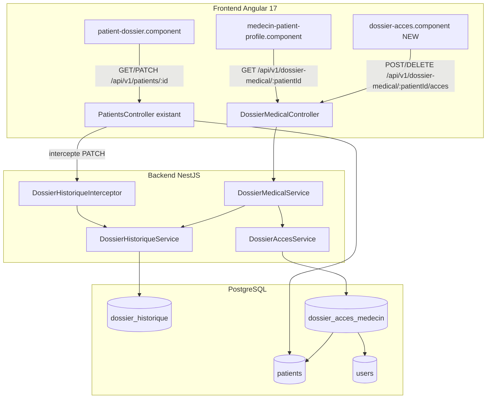
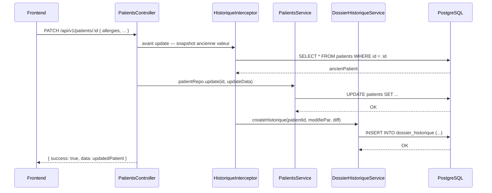
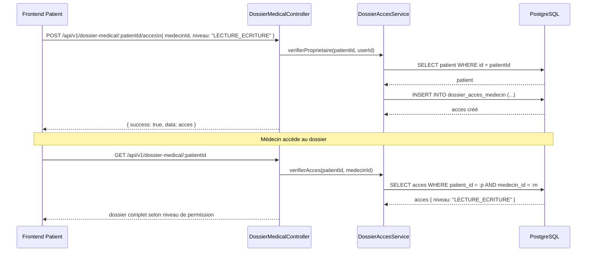
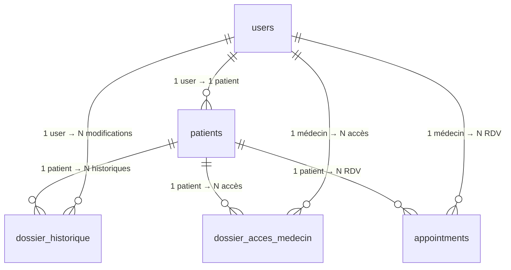

# Design Document : Dossier Médical

## Vue d'ensemble

Le module **Dossier Médical** enrichit la plateforme MediConnect avec deux fonctionnalités clés : un **historique versionné** de toutes les modifications apportées au dossier patient, et un système d'**accès partagé multi-médecins** avec permissions fines (lecture, lecture+écriture, accès complet). Il s'appuie sur les entités existantes `Patient`, `User` et `Appointment` sans les modifier structurellement.

---

## Architecture



---

## Diagrammes de séquence

### Modification du dossier avec historique



### Partage d'accès médecin



---

## Nouvelles entités

### DossierHistorique

Enregistre chaque modification du dossier patient avec un diff champ par champ.

```typescript
@Entity('dossier_historique')
@Index(['patientId', 'createdAt'])
export class DossierHistorique {
  @PrimaryGeneratedColumn('uuid')
  id: string;

  @Column({ name: 'patient_id', type: 'uuid' })
  patientId: string;

  @ManyToOne(() => Patient)
  @JoinColumn({ name: 'patient_id' })
  patient: Patient;

  // Auteur de la modification (patient lui-même ou médecin autorisé)
  @Column({ name: 'modifie_par_id', type: 'uuid' })
  modifieParId: string;

  @ManyToOne(() => User)
  @JoinColumn({ name: 'modifie_par_id' })
  modifiePar: User;

  // Rôle de l'auteur au moment de la modification
  @Column({ name: 'role_auteur', type: 'varchar', length: 50 })
  roleAuteur: string;

  // Champs modifiés : { allergies: { avant: [...], apres: [...] }, ... }
  @Column({ name: 'champs_modifies', type: 'jsonb' })
  champsModifies: Record<string, { avant: any; apres: any }>;

  // Snapshot complet du dossier avant modification (pour rollback éventuel)
  @Column({ name: 'snapshot_avant', type: 'jsonb' })
  snapshotAvant: Record<string, any>;

  @Column({ nullable: true, type: 'text' })
  commentaire: string;

  @CreateDateColumn({ name: 'created_at' })
  createdAt: Date;
}
```

### DossierAccesMedecin

Gère les permissions d'accès d'un médecin au dossier d'un patient.

```typescript
export enum NiveauAcces {
  LECTURE           = 'LECTURE',           // Consulter uniquement
  LECTURE_ECRITURE  = 'LECTURE_ECRITURE',  // Consulter + modifier
  ACCES_COMPLET     = 'ACCES_COMPLET',     // Modifier + voir historique + gérer accès
}

@Entity('dossier_acces_medecin')
@Unique(['patientId', 'medecinId'])
@Index(['patientId'])
@Index(['medecinId'])
export class DossierAccesMedecin {
  @PrimaryGeneratedColumn('uuid')
  id: string;

  @Column({ name: 'patient_id', type: 'uuid' })
  patientId: string;

  @ManyToOne(() => Patient)
  @JoinColumn({ name: 'patient_id' })
  patient: Patient;

  @Column({ name: 'medecin_id', type: 'uuid' })
  medecinId: string;

  @ManyToOne(() => User)
  @JoinColumn({ name: 'medecin_id' })
  medecin: User;

  @Column({
    name: 'niveau_acces',
    type: 'enum',
    enum: NiveauAcces,
    default: NiveauAcces.LECTURE,
  })
  niveauAcces: NiveauAcces;

  // Qui a accordé l'accès (patient ou médecin chef de service)
  @Column({ name: 'accorde_par_id', type: 'uuid' })
  accordeParId: string;

  @Column({ name: 'date_expiration', type: 'timestamptz', nullable: true })
  dateExpiration: Date | null;

  @Column({ default: true })
  actif: boolean;

  @CreateDateColumn({ name: 'created_at' })
  createdAt: Date;

  @UpdateDateColumn({ name: 'updated_at' })
  updatedAt: Date;
}
```

---

## Relations avec l'existant



---

## DTOs

### Gestion des accès

```typescript
// POST /dossier-medical/:patientId/acces
export class CreateAccesDto {
  @IsUUID()
  medecinId: string;

  @IsEnum(NiveauAcces)
  niveauAcces: NiveauAcces;

  @IsOptional()
  @IsDateString()
  dateExpiration?: string;
}

// PATCH /dossier-medical/:patientId/acces/:accesId
export class UpdateAccesDto {
  @IsOptional()
  @IsEnum(NiveauAcces)
  niveauAcces?: NiveauAcces;

  @IsOptional()
  @IsDateString()
  dateExpiration?: string;

  @IsOptional()
  @IsBoolean()
  actif?: boolean;
}
```

### Consultation de l'historique

```typescript
// GET /dossier-medical/:patientId/historique?page=1&limit=20&champ=allergies
export class HistoriqueQueryDto {
  @IsOptional()
  @IsInt()
  @Min(1)
  page?: number = 1;

  @IsOptional()
  @IsInt()
  @Min(1)
  @Max(100)
  limit?: number = 20;

  @IsOptional()
  @IsString()
  champ?: string; // filtrer par champ modifié

  @IsOptional()
  @IsUUID()
  modifieParId?: string;
}
```

---

## Services — signatures

### DossierHistoriqueService

```typescript
@Injectable()
export class DossierHistoriqueService {
  // Calcule le diff et persiste l'entrée d'historique
  async createHistorique(
    patientId: string,
    modifieParId: string,
    roleAuteur: string,
    snapshotAvant: Record<string, any>,
    snapshotApres: Record<string, any>,
    commentaire?: string,
  ): Promise<DossierHistorique>;

  // Retourne l'historique paginé d'un patient
  async getHistorique(
    patientId: string,
    query: HistoriqueQueryDto,
  ): Promise<{ data: DossierHistorique[]; total: number; page: number }>;

  // Calcule le diff entre deux snapshots
  private computeDiff(
    avant: Record<string, any>,
    apres: Record<string, any>,
  ): Record<string, { avant: any; apres: any }>;
}
```

### DossierAccesService

```typescript
@Injectable()
export class DossierAccesService {
  // Accorde l'accès à un médecin
  async accorderAcces(
    patientId: string,
    accordeParId: string,
    dto: CreateAccesDto,
  ): Promise<DossierAccesMedecin>;

  // Modifie le niveau ou la date d'expiration
  async modifierAcces(
    accesId: string,
    patientId: string,
    dto: UpdateAccesDto,
  ): Promise<DossierAccesMedecin>;

  // Révoque l'accès (soft delete via actif = false)
  async revoquerAcces(accesId: string, patientId: string): Promise<void>;

  // Liste les médecins ayant accès au dossier d'un patient
  async listerAcces(patientId: string): Promise<DossierAccesMedecin[]>;

  // Vérifie si un médecin a le niveau d'accès requis (lève ForbiddenException sinon)
  async verifierAcces(
    patientId: string,
    medecinId: string,
    niveauRequis: NiveauAcces,
  ): Promise<DossierAccesMedecin>;
}
```

### DossierMedicalService

```typescript
@Injectable()
export class DossierMedicalService {
  // Retourne le dossier complet selon le niveau d'accès du demandeur
  async getDossier(
    patientId: string,
    demandeurId: string,
    demandeurRole: string,
  ): Promise<DossierCompletDto>;

  // Mise à jour par un médecin autorisé (LECTURE_ECRITURE ou ACCES_COMPLET)
  async updateDossierParMedecin(
    patientId: string,
    medecinId: string,
    updateData: Partial<Patient>,
  ): Promise<Patient>;
}
```

---

## Contrôleur — signatures

```typescript
@ApiTags('dossier-medical')
@ApiBearerAuth()
@UseGuards(JwtAuthGuard)
@Controller('dossier-medical')
export class DossierMedicalController {

  // ── Dossier ──────────────────────────────────────────────────────────────

  // GET /dossier-medical/:patientId
  // Accessible : patient propriétaire + médecins avec accès actif
  @Get(':patientId')
  getDossier(@Param('patientId') patientId: string, @Req() req): Promise<DossierCompletDto>;

  // PATCH /dossier-medical/:patientId
  // Accessible : médecins avec LECTURE_ECRITURE ou ACCES_COMPLET
  @Patch(':patientId')
  updateDossier(
    @Param('patientId') patientId: string,
    @Body() body: UpdateDossierDto,
    @Req() req,
  ): Promise<Patient>;

  // ── Historique ────────────────────────────────────────────────────────────

  // GET /dossier-medical/:patientId/historique
  // Accessible : patient propriétaire + médecins avec ACCES_COMPLET
  @Get(':patientId/historique')
  getHistorique(
    @Param('patientId') patientId: string,
    @Query() query: HistoriqueQueryDto,
    @Req() req,
  ): Promise<{ data: DossierHistorique[]; total: number }>;

  // ── Accès médecins ────────────────────────────────────────────────────────

  // GET /dossier-medical/:patientId/acces
  @Get(':patientId/acces')
  listerAcces(@Param('patientId') patientId: string, @Req() req);

  // POST /dossier-medical/:patientId/acces
  @Post(':patientId/acces')
  accorderAcces(
    @Param('patientId') patientId: string,
    @Body() dto: CreateAccesDto,
    @Req() req,
  );

  // PATCH /dossier-medical/:patientId/acces/:accesId
  @Patch(':patientId/acces/:accesId')
  modifierAcces(
    @Param('patientId') patientId: string,
    @Param('accesId') accesId: string,
    @Body() dto: UpdateAccesDto,
    @Req() req,
  );

  // DELETE /dossier-medical/:patientId/acces/:accesId
  @Delete(':patientId/acces/:accesId')
  revoquerAcces(
    @Param('patientId') patientId: string,
    @Param('accesId') accesId: string,
    @Req() req,
  );
}
```

---

## Algorithme de diff (historique)

```typescript
// Champs du dossier patient suivis pour l'historique
const CHAMPS_SURVEILLES = [
  'allergies', 'maladiesChroniques', 'medicamentsActuels',
  'groupeSanguin', 'dateNaissance', 'sexe', 'ville',
  'telephone', 'nss', 'nom', 'prenom',
] as const;

function computeDiff(
  avant: Record<string, any>,
  apres: Record<string, any>,
): Record<string, { avant: any; apres: any }> {
  const diff: Record<string, { avant: any; apres: any }> = {};

  for (const champ of CHAMPS_SURVEILLES) {
    const valAvant = avant[champ];
    const valApres = apres[champ];

    // Comparaison deep pour les tableaux/objets
    if (JSON.stringify(valAvant) !== JSON.stringify(valApres)) {
      diff[champ] = { avant: valAvant, apres: valApres };
    }
  }

  return diff; // vide si aucun changement
}
```

**Préconditions :**
- `avant` et `apres` sont des snapshots valides de l'entité `Patient`
- Les deux objets contiennent les mêmes clés

**Postconditions :**
- Le résultat ne contient que les champs effectivement modifiés
- Si aucun champ n'a changé, retourne `{}`
- Chaque entrée du diff contient `avant` et `apres` non-null (peut être `[]` pour les tableaux)

---

## Algorithme de vérification d'accès

```typescript
async function verifierAcces(
  patientId: string,
  demandeurId: string,
  demandeurRole: string,
  niveauRequis: NiveauAcces,
): Promise<boolean> {
  // Le patient accède toujours à son propre dossier
  const patient = await patientRepo.findOne({ where: { id: patientId } });
  if (patient?.userId === demandeurId) return true;

  // ADMIN_SYSTEM a accès complet en lecture
  if (demandeurRole === UserRole.ADMIN_SYSTEM) return true;

  // Vérifier l'accès explicite
  const acces = await accesRepo.findOne({
    where: {
      patientId,
      medecinId: demandeurId,
      actif: true,
    },
  });

  if (!acces) throw new ForbiddenException('Accès non autorisé');

  // Vérifier expiration
  if (acces.dateExpiration && acces.dateExpiration < new Date()) {
    throw new ForbiddenException('Accès expiré');
  }

  // Hiérarchie des niveaux : ACCES_COMPLET > LECTURE_ECRITURE > LECTURE
  const hierarchie = {
    [NiveauAcces.LECTURE]: 1,
    [NiveauAcces.LECTURE_ECRITURE]: 2,
    [NiveauAcces.ACCES_COMPLET]: 3,
  };

  if (hierarchie[acces.niveauAcces] < hierarchie[niveauRequis]) {
    throw new ForbiddenException('Niveau d\'accès insuffisant');
  }

  return true;
}
```

**Préconditions :**
- `patientId` et `demandeurId` sont des UUIDs valides
- `niveauRequis` est une valeur de l'enum `NiveauAcces`

**Postconditions :**
- Retourne `true` si l'accès est autorisé
- Lève `ForbiddenException` si accès refusé ou expiré
- Le patient propriétaire a toujours accès (niveau ACCES_COMPLET implicite)

---

## Intégration avec le PATCH existant

Le `PatientsController.updateProfile()` existant doit être enrichi pour déclencher l'historique. L'approche recommandée est un **intercepteur NestJS** qui :

1. Capture le snapshot avant la modification
2. Laisse le handler existant s'exécuter
3. Capture le snapshot après
4. Appelle `DossierHistoriqueService.createHistorique()` si un diff existe

```typescript
@Injectable()
export class DossierHistoriqueInterceptor implements NestInterceptor {
  constructor(
    private readonly historiqueService: DossierHistoriqueService,
    @InjectRepository(Patient) private readonly patientRepo: Repository<Patient>,
  ) {}

  async intercept(context: ExecutionContext, next: CallHandler): Promise<Observable<any>> {
    const request = context.switchToHttp().getRequest();
    const patientId = request.params.id;
    const userId = request.user?.sub ?? request.user?.id;

    // Snapshot avant
    const avant = await this.patientRepo.findOne({ where: { id: patientId } });

    return next.handle().pipe(
      tap(async (response) => {
        if (response?.success && avant) {
          const apres = await this.patientRepo.findOne({ where: { id: patientId } });
          const diff = this.historiqueService.computeDiff(avant, apres);
          if (Object.keys(diff).length > 0) {
            await this.historiqueService.createHistorique(
              patientId, userId, request.user.role,
              avant, apres,
            );
          }
        }
      }),
    );
  }
}
```

---

## Gestion des erreurs

| Scénario | Code HTTP | Message |
|---|---|---|
| Patient introuvable | 404 | `Patient introuvable` |
| Médecin sans accès | 403 | `Accès non autorisé` |
| Accès expiré | 403 | `Accès expiré` |
| Niveau insuffisant | 403 | `Niveau d'accès insuffisant` |
| Accès déjà existant | 409 | `Un accès existe déjà pour ce médecin` |
| UUID invalide | 400 | Validation class-validator |

---

## Correctness Properties

*Une propriété est une caractéristique ou un comportement qui doit rester vrai pour toutes les exécutions valides du système — une spécification formelle de ce que le système doit faire. Les propriétés servent de pont entre les spécifications lisibles par l'humain et les garanties de correction vérifiables automatiquement.*

### Property 1 : Diff vide pour snapshots identiques

*Pour tout* snapshot `avant` et `apres` dont les valeurs de tous les champs de `CHAMPS_SURVEILLES` sont identiques, `computeDiff(avant, apres)` doit retourner un objet vide `{}`.

**Validates: Requirements 1.4**

### Property 2 : Diff contient uniquement les champs modifiés de CHAMPS_SURVEILLES

*Pour tout* couple de snapshots `(avant, apres)`, le résultat de `computeDiff` ne doit contenir que les clés présentes dans `CHAMPS_SURVEILLES` dont la valeur sérialisée JSON diffère entre `avant` et `apres`. Toute clé hors de `CHAMPS_SURVEILLES` ne doit jamais apparaître dans le diff, même si sa valeur a changé.

**Validates: Requirements 1.5, 1.6**

### Property 3 : Entrée d'historique créée si et seulement si le diff est non vide

*Pour tout* PATCH sur un patient, une entrée `DossierHistorique` est créée en base si et seulement si `computeDiff(avant, apres)` retourne un objet non vide. Chaque entrée créée doit contenir `patientId`, `modifieParId`, `roleAuteur`, `champsModifies` (le diff) et `snapshotAvant`.

**Validates: Requirements 1.3, 1.4**

### Property 4 : Transparence de l'intercepteur sur la réponse

*Pour toute* requête `PATCH /api/v1/patients/:id`, la réponse HTTP retournée au client doit être identique à celle que le `PatientsController` aurait retournée sans l'intercepteur (même corps, même code de statut).

**Validates: Requirements 1.7**

### Property 5 : Snapshots sans données sensibles

*Pour tout* snapshot persisté dans la table `dossier_historique` (champs `snapshotAvant` et `champsModifies`), les clés `password`, `mfaSecret` et `refreshToken` ne doivent jamais apparaître.

**Validates: Requirements 10.2**

### Property 6 : Hiérarchie transitive des niveaux d'accès

*Pour tout* niveau d'accès `n` possédé par un médecin et tout niveau requis `r`, l'accès est autorisé si et seulement si `hierarchie[n] >= hierarchie[r]`, où `hierarchie = { LECTURE: 1, LECTURE_ECRITURE: 2, ACCES_COMPLET: 3 }`. En particulier : `ACCES_COMPLET` satisfait `LECTURE_ECRITURE` et `LECTURE` ; `LECTURE_ECRITURE` satisfait `LECTURE` mais pas `ACCES_COMPLET` ; `LECTURE` ne satisfait que `LECTURE`.

**Validates: Requirements 8.1, 8.2, 8.3**

### Property 7 : Contrôle d'accès — non-propriétaire rejeté

*Pour toute* route de mutation ou de lecture sensible du module (`POST/PATCH/DELETE /acces`, `GET /acces`, `GET /historique`), une requête émise par un utilisateur dont l'identifiant ne correspond pas au `Patient_Proprietaire` et qui ne possède pas d'entrée `DossierAccesMedecin` active doit recevoir une réponse HTTP 403.

**Validates: Requirements 2.3, 3.3, 4.4, 5.5, 6.3, 7.2**

### Property 8 : Soft delete préserve l'entrée en base

*Pour tout* accès `DossierAccesMedecin` révoqué (via `DELETE`) ou désactivé (via `PATCH actif = false`), l'entrée doit toujours exister en base avec `actif = false` après l'opération.

**Validates: Requirements 5.3, 6.1, 6.2**

### Property 9 : Round-trip création d'accès

*Pour tout* `CreateAccesDto` valide soumis par un `Patient_Proprietaire`, l'entrée `DossierAccesMedecin` créée doit refléter exactement les valeurs fournies (`medecinId`, `niveauAcces`, `dateExpiration`) et avoir `actif = true` et `accordeParId` égal à l'identifiant du demandeur.

**Validates: Requirements 4.1, 4.3, 4.5**

### Property 10 : Résultats d'historique triés et bornés

*Pour toute* réponse de `GET /dossier-medical/:patientId/historique`, les entrées retournées doivent être triées par `createdAt` décroissant, leur nombre doit être inférieur ou égal à `limit` (défaut 20, max 100), et la réponse doit inclure les champs `total` et `page`.

**Validates: Requirements 2.4, 2.5, 2.8**

### Property 11 : Filtrage de l'historique par champ et par auteur

*Pour toute* réponse de `GET /dossier-medical/:patientId/historique` avec un filtre `champ=X`, toutes les entrées retournées doivent avoir la clé `X` dans `champsModifies`. *Pour toute* réponse avec un filtre `modifieParId=Y`, toutes les entrées retournées doivent avoir `modifieParId = Y`.

**Validates: Requirements 2.6, 2.7**

---

## Stratégie de tests

### Tests unitaires

- `DossierHistoriqueService.computeDiff()` : cas vide, modification simple, modification tableau
- `DossierAccesService.verifierAcces()` : propriétaire, médecin autorisé, médecin non autorisé, accès expiré, hiérarchie des niveaux
- Accès expiré → 403 après la date d'expiration (edge case temporel)
- Couple `(patientId, medecinId)` déjà existant → 409 (edge case d'unicité)
- UUID invalide dans les paramètres → 400 (edge case de validation)
- Route `DELETE /dossier-historique` inexistante → 404/405 (append-only)

### Tests de propriétés (fast-check)

Voir la section **Correctness Properties** ci-dessus. Configuration minimale : 100 itérations par propriété.

Tag format : `Feature: dossier-medical, Property {N}: {titre}`

### Tests d'intégration

- `PATCH /api/v1/patients/:id` crée bien une entrée dans `dossier_historique`
- `POST /dossier-medical/:patientId/acces` + `GET /dossier-medical/:patientId` retourne le dossier selon le niveau
- Requête sans token JWT → 401 sur toutes les routes du `DossierMedicalController`

---

## Considérations de sécurité

- Toutes les routes sont protégées par `JwtAuthGuard`
- La vérification de propriété (patient = userId) est faite côté service, jamais côté client
- Les snapshots JSONB ne contiennent pas le mot de passe ni les tokens
- L'historique est en **append-only** : aucune route de suppression d'entrée d'historique
- Les accès expirés sont conservés en base (soft) pour audit

## Dépendances

- `@nestjs/typeorm` + `typeorm` (déjà présents)
- `class-validator` + `class-transformer` (déjà présents)
- `rxjs` pour l'intercepteur (déjà présent avec NestJS)
- Aucune nouvelle dépendance npm requise
