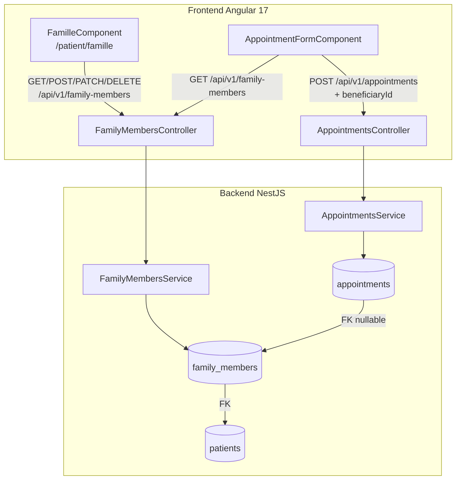
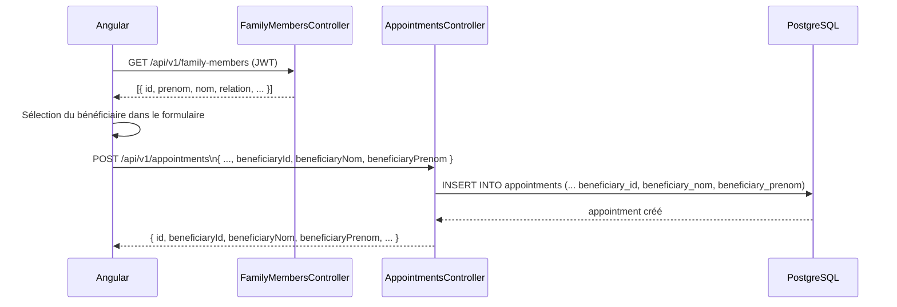

# Design Document : Gestion des Profils Familiaux (famille-profils)

## Vue d'ensemble

Le module **Famille Profils** permet à un patient de gérer les profils de ses proches (enfants, conjoint, parents, autres) et de prendre des rendez-vous en leur nom. Il introduit une nouvelle table `family_members`, deux colonnes dénormalisées sur `appointments`, un module NestJS dédié, et une page Angular `/patient/famille`.

L'approche de dénormalisation (`beneficiaryNom`, `beneficiaryPrenom` sur `appointments`) garantit que les données historiques des RDV restent intactes même si un profil familial est supprimé ultérieurement.

---

## Architecture



---

## Diagramme de séquence — Prise de RDV pour un proche



---

## Modèles de données

### Nouvelle table `family_members`

```sql
CREATE TYPE relation_type AS ENUM ('ENFANT', 'CONJOINT', 'PARENT', 'AUTRE');

CREATE TABLE family_members (
    id              UUID PRIMARY KEY DEFAULT gen_random_uuid(),
    patient_id      UUID NOT NULL REFERENCES patients(id) ON DELETE CASCADE,
    prenom          VARCHAR(100) NOT NULL,
    nom             VARCHAR(100) NOT NULL,
    date_naissance  DATE NOT NULL,
    relation        relation_type NOT NULL,
    sexe            CHAR(1) NOT NULL CHECK (sexe IN ('M', 'F')),
    nss             VARCHAR(50),
    allergies       JSONB DEFAULT '[]',
    groupe_sanguin  VARCHAR(5),
    created_at      TIMESTAMPTZ NOT NULL DEFAULT NOW(),
    updated_at      TIMESTAMPTZ NOT NULL DEFAULT NOW(),
    deleted_at      TIMESTAMPTZ
);

CREATE INDEX idx_family_members_patient_id ON family_members(patient_id) WHERE deleted_at IS NULL;
```

### Modification table `appointments`

```sql
ALTER TABLE appointments
    ADD COLUMN beneficiary_id     UUID REFERENCES family_members(id) ON DELETE SET NULL,
    ADD COLUMN beneficiary_nom    VARCHAR(100),
    ADD COLUMN beneficiary_prenom VARCHAR(100);
```

> Les colonnes `beneficiary_nom` et `beneficiary_prenom` sont dénormalisées intentionnellement : elles préservent l'identité du bénéficiaire même après suppression du profil familial.

### Diagramme ER

```mermaid
erDiagram
    patients ||--o{ family_members : "1 patient → N membres"
    patients ||--o{ appointments : "1 patient → N RDV"
    family_members ||--o{ appointments : "1 membre → N RDV (nullable)"

    family_members {
        uuid id PK
        uuid patient_id FK
        varchar prenom
        varchar nom
        date date_naissance
        enum relation
        char sexe
        varchar nss
        jsonb allergies
        varchar groupe_sanguin
        timestamptz created_at
        timestamptz updated_at
        timestamptz deleted_at
    }

    appointments {
        uuid id PK
        uuid patient_id FK
        uuid doctor_id FK
        uuid beneficiary_id FK_nullable
        varchar beneficiary_nom
        varchar beneficiary_prenom
        timestamptz appointment_date
        enum status
        enum consultation_type
    }
```

---

## Composants et interfaces

### Backend NestJS — `FamilyMembersModule`

#### Entity

```typescript
export enum Relation {
  ENFANT   = 'ENFANT',
  CONJOINT = 'CONJOINT',
  PARENT   = 'PARENT',
  AUTRE    = 'AUTRE',
}

@Entity('family_members')
@Index(['patientId'], { where: '"deleted_at" IS NULL' })
export class FamilyMember {
  @PrimaryGeneratedColumn('uuid')
  id: string;

  @Column({ name: 'patient_id', type: 'uuid' })
  patientId: string;

  @ManyToOne(() => Patient)
  @JoinColumn({ name: 'patient_id' })
  patient: Patient;

  @Column({ length: 100 })
  prenom: string;

  @Column({ length: 100 })
  nom: string;

  @Column({ name: 'date_naissance', type: 'date' })
  dateNaissance: Date;

  @Column({ type: 'enum', enum: Relation })
  relation: Relation;

  @Column({ length: 1 })
  sexe: string; // 'M' | 'F'

  @Column({ nullable: true, length: 50 })
  nss: string;

  @Column({ type: 'jsonb', default: '[]' })
  allergies: string[];

  @Column({ name: 'groupe_sanguin', nullable: true, length: 5 })
  groupeSanguin: string;

  @CreateDateColumn({ name: 'created_at' })
  createdAt: Date;

  @UpdateDateColumn({ name: 'updated_at' })
  updatedAt: Date;

  @DeleteDateColumn({ name: 'deleted_at' })
  deletedAt: Date;
}
```

#### DTOs

```typescript
// POST /api/v1/family-members
export class CreateFamilyMemberDto {
  @IsString() @MaxLength(100)
  prenom: string;

  @IsString() @MaxLength(100)
  nom: string;

  @IsDateString()
  dateNaissance: string;

  @IsEnum(Relation)
  relation: Relation;

  @IsIn(['M', 'F'])
  sexe: string;

  @IsOptional() @IsString() @MaxLength(50)
  nss?: string;

  @IsOptional() @IsArray() @IsString({ each: true })
  allergies?: string[];

  @IsOptional() @IsString() @MaxLength(5)
  groupeSanguin?: string;
}

// PATCH /api/v1/family-members/:id
export class UpdateFamilyMemberDto extends PartialType(CreateFamilyMemberDto) {}
```

#### Service — signatures

```typescript
@Injectable()
export class FamilyMembersService {
  // Retourne les membres non supprimés du patient
  async findAllByPatient(patientId: string): Promise<FamilyMember[]>;

  // Crée un membre et vérifie que patientId appartient au user connecté
  async create(patientId: string, dto: CreateFamilyMemberDto): Promise<FamilyMember>;

  // Mise à jour partielle — vérifie ownership
  async update(id: string, patientId: string, dto: UpdateFamilyMemberDto): Promise<FamilyMember>;

  // Soft delete via TypeORM @DeleteDateColumn
  async remove(id: string, patientId: string): Promise<void>;

  // Résout le patientId depuis le userId JWT
  async resolvePatientId(userId: string): Promise<string>;

  // Vérifie que le membre appartient au patient (lève 403 sinon)
  private async assertOwnership(id: string, patientId: string): Promise<FamilyMember>;
}
```

#### Contrôleur — endpoints

```typescript
@ApiTags('family-members')
@ApiBearerAuth()
@UseGuards(JwtAuthGuard)
@Controller('family-members')
export class FamilyMembersController {

  // GET /api/v1/family-members
  // Retourne les membres familiaux du patient connecté
  @Get()
  findAll(@Req() req): Promise<FamilyMember[]>;

  // POST /api/v1/family-members
  // Crée un nouveau membre familial
  @Post()
  create(@Body() dto: CreateFamilyMemberDto, @Req() req): Promise<FamilyMember>;

  // PATCH /api/v1/family-members/:id
  // Met à jour un membre (ownership vérifié)
  @Patch(':id')
  update(
    @Param('id', ParseUUIDPipe) id: string,
    @Body() dto: UpdateFamilyMemberDto,
    @Req() req,
  ): Promise<FamilyMember>;

  // DELETE /api/v1/family-members/:id
  // Soft-delete (ownership vérifié)
  @Delete(':id')
  remove(@Param('id', ParseUUIDPipe) id: string, @Req() req): Promise<void>;
}
```

### Modification `AppointmentsController` / `AppointmentsService`

#### DTO mis à jour

```typescript
// Ajout dans CreateAppointmentDto
export class CreateAppointmentDto {
  // ... champs existants ...

  @IsOptional() @IsUUID()
  beneficiaryId?: string;

  @IsOptional() @IsString() @MaxLength(100)
  beneficiaryNom?: string;

  @IsOptional() @IsString() @MaxLength(100)
  beneficiaryPrenom?: string;
}
```

#### Modification entity `Appointment`

```typescript
// Ajout dans appointment.entity.ts
@Column({ name: 'beneficiary_id', type: 'uuid', nullable: true })
beneficiaryId: string | null;

@ManyToOne(() => FamilyMember, { nullable: true, eager: false })
@JoinColumn({ name: 'beneficiary_id' })
beneficiary: FamilyMember;

@Column({ name: 'beneficiary_nom', nullable: true, length: 100 })
beneficiaryNom: string | null;

@Column({ name: 'beneficiary_prenom', nullable: true, length: 100 })
beneficiaryPrenom: string | null;
```

---

## Composants Angular

### Structure des fichiers

```
frontend/src/app/modules/patient/pages/famille/
├── famille.component.ts          # Page principale (liste + modal)
├── famille.component.html
├── famille.component.scss
└── family-member-form/
    └── family-member-form.component.ts  # Formulaire réutilisable (modal)

frontend/src/app/core/
├── models/
│   └── family-member.model.ts
└── services/
    └── family-members.service.ts
```

### Modèle TypeScript

```typescript
// family-member.model.ts
export type Relation = 'ENFANT' | 'CONJOINT' | 'PARENT' | 'AUTRE';

export interface FamilyMember {
  id: string;
  patientId: string;
  prenom: string;
  nom: string;
  dateNaissance: string;
  relation: Relation;
  sexe: 'M' | 'F';
  nss?: string;
  allergies?: string[];
  groupeSanguin?: string;
  createdAt: string;
  updatedAt: string;
}

export interface CreateFamilyMemberPayload {
  prenom: string;
  nom: string;
  dateNaissance: string;
  relation: Relation;
  sexe: 'M' | 'F';
  nss?: string;
  allergies?: string[];
  groupeSanguin?: string;
}
```

### Service Angular

```typescript
// family-members.service.ts
@Injectable({ providedIn: 'root' })
export class FamilyMembersService {
  private readonly http = inject(HttpClient);
  private readonly base = '/api/v1/family-members';

  getAll(): Observable<FamilyMember[]>;
  create(payload: CreateFamilyMemberPayload): Observable<FamilyMember>;
  update(id: string, payload: Partial<CreateFamilyMemberPayload>): Observable<FamilyMember>;
  remove(id: string): Observable<void>;
}
```

### Page `FamilleComponent`

Structure de la page `/patient/famille` :

```
┌─────────────────────────────────────────────────────┐
│  Mes proches                          [+ Ajouter]   │
├─────────────────────────────────────────────────────┤
│  ┌──────────────────────────────────────────────┐   │
│  │ 👶 Emma Dupont          Enfant   [✏️] [🗑️]  │   │
│  │    Née le 12/03/2018 · F                     │   │
│  └──────────────────────────────────────────────┘   │
│  ┌──────────────────────────────────────────────┐   │
│  │ 👫 Marc Dupont          Conjoint [✏️] [🗑️]  │   │
│  │    Né le 05/07/1985 · M                      │   │
│  └──────────────────────────────────────────────┘   │
│                                                     │
│  [Modal Ajout/Édition — voir ci-dessous]            │
└─────────────────────────────────────────────────────┘
```

Composant standalone Angular 17 :

```typescript
@Component({
  selector: 'app-famille',
  standalone: true,
  imports: [CommonModule, ReactiveFormsModule, TranslateModule],
  // template inline ou fichier séparé
})
export class FamilleComponent {
  private svc = inject(FamilyMembersService);

  members = signal<FamilyMember[]>([]);
  showModal = signal(false);
  editingMember = signal<FamilyMember | null>(null);
  isLoading = signal(false);

  ngOnInit(): void { this.load(); }

  load(): void { this.svc.getAll().subscribe(m => this.members.set(m)); }
  openAdd(): void { this.editingMember.set(null); this.showModal.set(true); }
  openEdit(m: FamilyMember): void { this.editingMember.set(m); this.showModal.set(true); }
  onSaved(): void { this.showModal.set(false); this.load(); }
  onDelete(id: string): void { this.svc.remove(id).subscribe(() => this.load()); }
}
```

### Modification `AppointmentFormComponent`

Ajout d'un sélecteur de bénéficiaire dans le formulaire existant :

```typescript
// Nouveau champ dans le FormGroup
beneficiaryId: [null],  // null = patient lui-même

// Chargement des membres familiaux
familyMembers = signal<FamilyMember[]>([]);

ngOnInit(): void {
  // ... code existant ...
  this.familyMembersService.getAll().subscribe(m => this.familyMembers.set(m));
}
```

Template ajouté avant le champ "Motif" :

```html
<!-- Bénéficiaire -->
<div class="form-group">
  <label class="form-label">Pour qui est ce rendez-vous ?</label>
  <select formControlName="beneficiaryId" class="form-select">
    <option [value]="null">Moi-même</option>
    <option *ngFor="let m of familyMembers()" [value]="m.id">
      {{ m.prenom }} {{ m.nom }} ({{ m.relation | lowercase }})
    </option>
  </select>
</div>
```

### Route Angular à ajouter

```typescript
// Dans patient.routes.ts
{
  path: 'famille',
  loadComponent: () =>
    import('./pages/famille/famille.component').then(m => m.FamilleComponent),
},
```

---

## Gestion des erreurs

| Scénario | Code HTTP | Message |
|---|---|---|
| Patient introuvable depuis userId | 404 | `Profil patient introuvable` |
| Membre familial introuvable | 404 | `Membre familial introuvable` |
| Accès à un membre d'un autre patient | 403 | `Accès non autorisé` |
| Champs requis manquants | 400 | Validation class-validator |
| UUID invalide dans les paramètres | 400 | `Validation failed (uuid is expected)` |
| beneficiaryId ne correspond pas au patient | 400 | `Ce membre familial n'appartient pas à ce patient` |

---

## Correctness Properties

*Une propriété est une caractéristique ou un comportement qui doit rester vrai pour toutes les exécutions valides du système — une spécification formelle de ce que le système doit faire. Les propriétés servent de pont entre les spécifications lisibles par l'humain et les garanties de correction vérifiables automatiquement.*

### Property 1 : Round-trip création d'un membre familial

*Pour tout* `CreateFamilyMemberDto` valide (prenom, nom, dateNaissance, relation, sexe renseignés), créer un membre puis le récupérer par son `id` doit retourner un objet dont les champs correspondent exactement aux valeurs soumises, avec un `id` UUID généré et `deletedAt` null.

**Validates: Requirements 1.2**

### Property 2 : Rejet des DTOs invalides

*Pour tout* `CreateFamilyMemberDto` dont au moins un champ requis (prenom, nom, dateNaissance, relation, sexe) est absent ou invalide, la requête `POST /api/v1/family-members` doit retourner HTTP 400 et aucun enregistrement ne doit être créé en base.

**Validates: Requirements 1.3**

### Property 3 : Round-trip mise à jour partielle

*Pour tout* membre familial existant et tout `UpdateFamilyMemberDto` partiel valide, après `PATCH`, les champs fournis doivent refléter les nouvelles valeurs et les champs non fournis doivent rester inchangés.

**Validates: Requirements 1.4**

### Property 4 : Soft-delete exclut des listings

*Pour tout* membre familial soft-supprimé (DELETE), il ne doit plus apparaître dans la réponse de `GET /api/v1/family-members`, mais son enregistrement doit toujours exister en base avec `deleted_at` non null.

**Validates: Requirements 1.5, 3.2**

### Property 5 : Isolation par patient (contrôle d'accès)

*Pour tout* membre familial appartenant au patient A, une requête PATCH ou DELETE émise par le patient B (B ≠ A) doit retourner HTTP 403, et l'enregistrement doit rester inchangé en base.

**Validates: Requirements 1.6**

### Property 6 : Round-trip bénéficiaire sur un RDV

*Pour tout* RDV créé avec un `beneficiaryId` valide, la réponse et la lecture ultérieure du RDV doivent contenir `beneficiaryId`, `beneficiaryNom` et `beneficiaryPrenom` correspondant au membre familial sélectionné.

**Validates: Requirements 2.3, 2.4**

### Property 7 : Dénormalisation préserve les données après suppression

*Pour tout* RDV dont le `beneficiaryId` référence un membre familial, après soft-delete de ce membre, les champs `beneficiary_nom` et `beneficiary_prenom` du RDV doivent rester inchangés en base.

**Validates: Requirements 3.1**

### Property 8 : Listing ne retourne que les membres actifs

*Pour tout* patient, `GET /api/v1/family-members` ne doit jamais retourner d'enregistrement dont `deleted_at` est non null.

**Validates: Requirements 3.2**

---

## Stratégie de tests

### Tests unitaires

- `FamilyMembersService.assertOwnership()` : propriétaire → OK, autre patient → 403
- `FamilyMembersService.remove()` : vérifie que `softDelete()` est appelé (pas `delete()`)
- `FamilyMembersService.resolvePatientId()` : userId valide → patientId, userId inconnu → 404
- `AppointmentsService.create()` avec `beneficiaryId` : vérifie que les champs dénormalisés sont copiés
- Validation DTO : sexe hors `['M','F']` → 400, relation hors enum → 400 (edge cases)
- `beneficiaryId` appartenant à un autre patient → 400 (edge case de sécurité)

### Tests de propriétés (fast-check)

Bibliothèque : **fast-check** (déjà compatible TypeScript/NestJS).
Configuration : minimum **100 itérations** par propriété.
Tag format : `Feature: famille-profils, Property {N}: {titre}`

| Propriété | Test fast-check |
|---|---|
| Property 1 | Générer des DTOs valides aléatoires → créer → récupérer → comparer |
| Property 2 | Générer des DTOs avec champs requis manquants → vérifier HTTP 400 |
| Property 3 | Générer un membre + un patch partiel aléatoire → vérifier invariants |
| Property 4 | Créer N membres → en supprimer K → vérifier que le listing retourne N-K |
| Property 5 | Générer deux patientIds distincts → vérifier 403 sur accès croisé |
| Property 6 | Générer un RDV avec beneficiaryId → vérifier round-trip des 3 champs |
| Property 7 | Créer RDV avec bénéficiaire → supprimer bénéficiaire → vérifier champs RDV inchangés |
| Property 8 | Créer N membres, en supprimer K → vérifier que listing.length === N-K |

### Tests d'intégration

- `POST /api/v1/family-members` → `GET /api/v1/family-members` : le membre créé apparaît
- `DELETE /api/v1/family-members/:id` → `GET /api/v1/family-members` : le membre n'apparaît plus
- `POST /api/v1/appointments` avec `beneficiaryId` → `GET /api/v1/appointments` : champs bénéficiaire présents
- Requête sans JWT → 401 sur toutes les routes `FamilyMembersController`
- Requête avec JWT d'un autre patient → 403 sur PATCH/DELETE

---

## Considérations de sécurité

- Toutes les routes `FamilyMembersController` sont protégées par `JwtAuthGuard`
- Le `patientId` est toujours résolu depuis `req.user.id` côté serveur, jamais depuis le body
- La vérification d'ownership est faite dans le service avant toute mutation
- Le `beneficiaryId` fourni lors d'un RDV est validé : il doit appartenir au patient connecté
- Le NSS du membre familial est nullable et ne doit pas être exposé dans les listings publics
