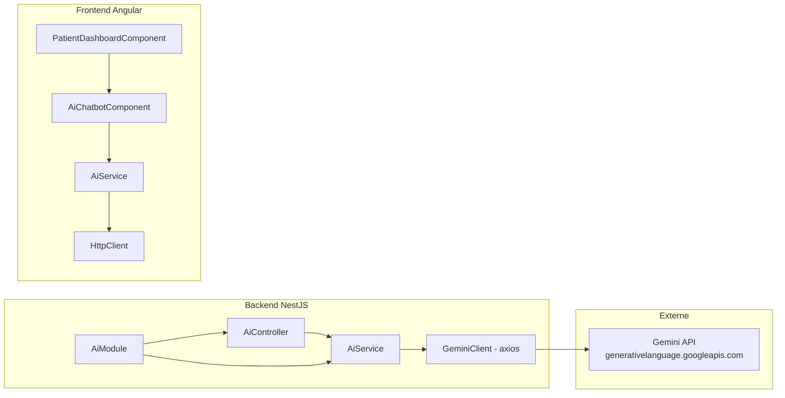
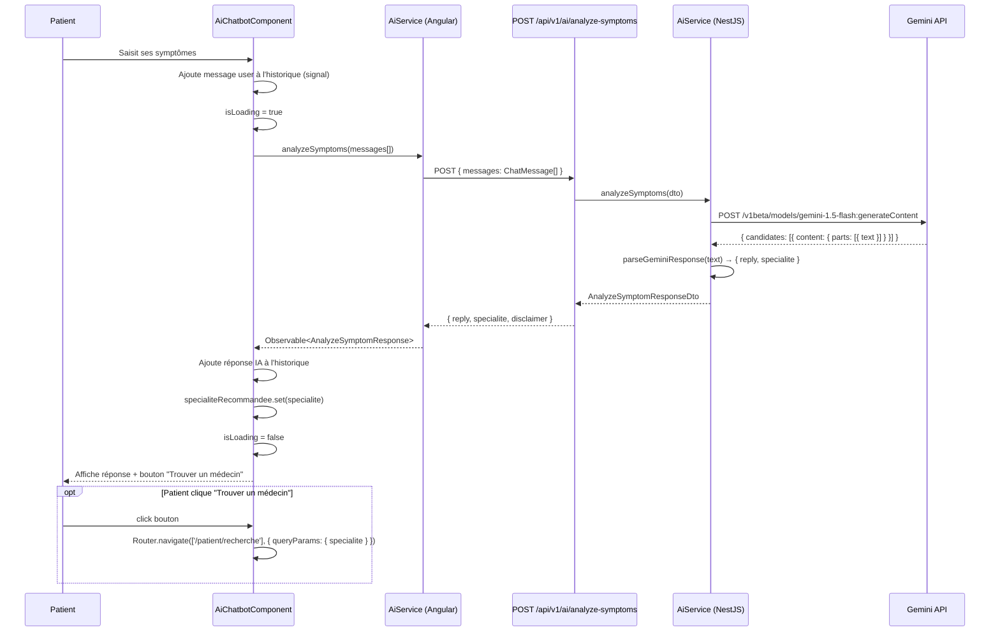
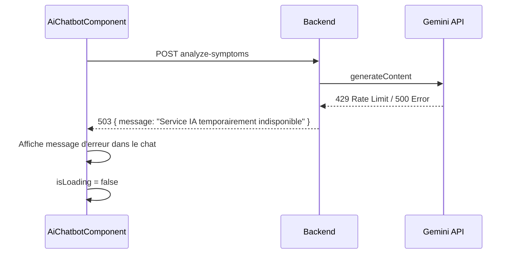

# Document de Design : ia-symptomes-orientation

## Vue d'ensemble

Intégration d'un chatbot IA dans le dashboard patient de MediConnect, utilisant l'API Google Gemini (gratuit) pour analyser les symptômes décrits en français, arabe ou anglais, et recommander la spécialité médicale appropriée. Le patient peut ensuite être redirigé vers la recherche de médecins filtrée par la spécialité recommandée.

Le module est entièrement stateless côté base de données : l'historique de conversation est maintenu en mémoire dans la session Angular uniquement. Aucune persistance en base n'est requise.

---

## Architecture

```mermaid
graph TD
    A[PatientDashboardComponent] --> B[AiChatbotComponent]
    B --> C[AiService Angular]
    C --> D[POST /api/v1/ai/analyze-symptoms]
    D --> E[AiController NestJS]
    E --> F[AiService NestJS]
    F --> G[Google Gemini REST API]
    G --> F
    F --> E
    E --> D
    D --> C
    C --> B
    B --> H[Router Angular]
    H --> I[/patient/recherche?specialite=...]
```



---

## Diagrammes de séquence

### Flux principal : analyse de symptômes



### Flux d'erreur



---

## Composants et Interfaces

### Backend : AiModule

**Rôle** : Module NestJS autonome qui encapsule toute la logique d'appel à Gemini.

**Structure** :
```
backend/src/modules/ai/
├── ai.module.ts
├── ai.controller.ts
├── ai.service.ts
└── dto/
    ├── analyze-symptoms.dto.ts
    └── analyze-symptoms-response.dto.ts
```

**Interface du contrôleur** :
```typescript
// POST /api/v1/ai/analyze-symptoms
// Guards: JwtAuthGuard, RolesGuard (PATIENT uniquement)
analyzeSymptoms(
  dto: AnalyzeSymptomsDto,
  user: CurrentUser
): Promise<AnalyzeSymptomsResponseDto>
```

**Responsabilités** :
- Valider le DTO entrant
- Appeler `AiService.analyzeSymptoms()`
- Retourner la réponse formatée avec disclaimer

### Backend : AiService

**Rôle** : Construit le prompt Gemini, appelle l'API REST, parse la réponse.

**Interface** :
```typescript
analyzeSymptoms(messages: ChatMessageDto[]): Promise<{
  reply: string;
  specialite: string | null;
}>
```

**Responsabilités** :
- Construire le prompt système médical multilingue
- Appeler `https://generativelanguage.googleapis.com/v1beta/models/gemini-1.5-flash:generateContent`
- Parser la réponse JSON structurée retournée par Gemini
- Gérer les erreurs API (rate limit, timeout, erreur réseau)

### Frontend : AiChatbotComponent

**Rôle** : Composant standalone Angular 17 avec signals, intégré dans le dashboard patient.

**Interface** :
```typescript
// Inputs/Outputs
// Aucun input requis — composant autonome

// Signals internes
messages: Signal<ChatMessage[]>
isLoading: Signal<boolean>
specialiteRecommandee: Signal<string | null>
userInput: Signal<string>
```

**Responsabilités** :
- Afficher l'historique de conversation (session uniquement)
- Envoyer les messages au backend via `AiService`
- Afficher le disclaimer médical en permanence
- Afficher le bouton "Trouver un médecin" quand une spécialité est recommandée
- Naviguer vers `/patient/recherche?specialite=XXX`

### Frontend : AiService (Angular)

**Rôle** : Service Angular qui communique avec le backend.

```typescript
analyzeSymptoms(messages: ChatMessage[]): Observable<AnalyzeSymptomResponse>
```

---

## Modèles de données

### DTOs Backend

```typescript
// analyze-symptoms.dto.ts
export class ChatMessageDto {
  @IsEnum(['user', 'assistant'])
  role: 'user' | 'assistant';

  @IsString()
  @MaxLength(2000)
  content: string;
}

export class AnalyzeSymptomsDto {
  @IsArray()
  @ArrayMaxSize(20)
  @ValidateNested({ each: true })
  @Type(() => ChatMessageDto)
  messages: ChatMessageDto[];
}

// analyze-symptoms-response.dto.ts
export class AnalyzeSymptomsResponseDto {
  reply: string;           // Réponse textuelle de l'IA
  specialite: string | null; // Ex: "CARDIOLOGUE", null si pas encore déterminé
  disclaimer: string;      // Avertissement médical fixe
}
```

### Modèles Frontend

```typescript
// ai-chat.model.ts
export interface ChatMessage {
  role: 'user' | 'assistant';
  content: string;
  timestamp: Date;
}

export interface AnalyzeSymptomResponse {
  reply: string;
  specialite: string | null;
  disclaimer: string;
}
```

### Mapping spécialités

Le backend retourne une valeur de l'enum existant dans le projet (cohérent avec `topSpecialites` du dashboard) :

```typescript
// Valeurs retournées par Gemini (instruites dans le prompt)
const SPECIALITES_VALIDES = [
  'CARDIOLOGUE', 'DERMATOLOGUE', 'GYNECOLOGUE', 'NEUROLOGUE',
  'OPHTALMOLOGUE', 'ORL', 'PEDIATRE', 'PSYCHIATRE', 'RHUMATOLOGUE',
  'UROLOGUE', 'CHIRURGIEN', 'ENDOCRINOLOGUE', 'GASTROLOGUE',
  'NEPHROLOGUE', 'ONCOLOGUE', 'PNEUMOLOGUE', 'MEDECIN_FAMILLE',
  'URGENTISTE', 'ANESTHESISTE', 'RADIOLOGUE_SPEC'
] as const;
```

---

## Pseudocode algorithmique

### Algorithme principal : buildGeminiPrompt

```pascal
ALGORITHM buildGeminiPrompt(messages: ChatMessageDto[])
INPUT: messages — historique de la conversation
OUTPUT: GeminiRequestPayload

BEGIN
  systemPrompt ← CONCAT(
    "Tu es un assistant médical de MediConnect. ",
    "Analyse les symptômes décrits et recommande une spécialité médicale. ",
    "Réponds TOUJOURS en JSON strict: ",
    '{"reply": "<réponse empathique>", "specialite": "<VALEUR_ENUM ou null>"}',
    "Spécialités valides: CARDIOLOGUE, DERMATOLOGUE, GYNECOLOGUE, ...",
    "IMPORTANT: Tu n'es pas un médecin. Recommande toujours de consulter un professionnel.",
    "Réponds dans la langue du patient (fr/ar/en)."
  )

  contents ← []

  // Ajouter le message système comme premier tour user/model
  contents.push({ role: "user", parts: [{ text: systemPrompt }] })
  contents.push({ role: "model", parts: [{ text: '{"reply": "Bonjour! Décrivez vos symptômes.", "specialite": null}' }] })

  // Ajouter l'historique de conversation
  FOR each msg IN messages DO
    geminiRole ← IF msg.role = "user" THEN "user" ELSE "model"
    contents.push({ role: geminiRole, parts: [{ text: msg.content }] })
  END FOR

  RETURN {
    contents: contents,
    generationConfig: {
      temperature: 0.3,
      maxOutputTokens: 512,
      responseMimeType: "application/json"
    }
  }
END
```

**Préconditions** :
- `messages` est un tableau non vide
- Chaque message a `role` ∈ {"user", "assistant"} et `content` non vide

**Postconditions** :
- Le payload retourné est valide pour l'API Gemini
- Le message système est toujours le premier élément de `contents`
- La configuration force une réponse JSON

### Algorithme : parseGeminiResponse

```pascal
ALGORITHM parseGeminiResponse(rawText: string)
INPUT: rawText — texte brut retourné par Gemini
OUTPUT: { reply: string, specialite: string | null }

BEGIN
  TRY
    parsed ← JSON.parse(rawText)

    reply ← parsed.reply IF parsed.reply IS string AND NOT empty
             ELSE "Je n'ai pas pu analyser vos symptômes. Veuillez réessayer."

    specialite ← parsed.specialite IF parsed.specialite IN SPECIALITES_VALIDES
                  ELSE null

    RETURN { reply, specialite }

  CATCH parseError
    // Gemini a retourné du texte non-JSON (cas rare avec responseMimeType)
    RETURN {
      reply: rawText.substring(0, 500),
      specialite: null
    }
  END TRY
END
```

**Préconditions** :
- `rawText` est la chaîne extraite de `candidates[0].content.parts[0].text`

**Postconditions** :
- `reply` est toujours une chaîne non vide
- `specialite` est soit une valeur de `SPECIALITES_VALIDES`, soit `null`
- Aucune exception n'est propagée

### Algorithme : handleUserMessage (Frontend)

```pascal
ALGORITHM handleUserMessage(userText: string)
INPUT: userText — texte saisi par le patient
OUTPUT: void (mise à jour des signals)

PRECONDITION: userText.trim() ≠ "" AND isLoading() = false

BEGIN
  // 1. Ajouter le message utilisateur à l'historique
  newUserMsg ← { role: "user", content: userText.trim(), timestamp: now() }
  messages.update(msgs => [...msgs, newUserMsg])
  userInput.set("")
  isLoading.set(true)

  // 2. Appeler le backend
  aiService.analyzeSymptoms(messages())
    .pipe(
      catchError(err → {
        errorMsg ← { role: "assistant", content: "Service temporairement indisponible.", timestamp: now() }
        messages.update(msgs → [...msgs, errorMsg])
        isLoading.set(false)
        RETURN EMPTY
      })
    )
    .subscribe(response → {
      // 3. Ajouter la réponse IA
      assistantMsg ← { role: "assistant", content: response.reply, timestamp: now() }
      messages.update(msgs → [...msgs, assistantMsg])

      // 4. Mettre à jour la spécialité recommandée
      IF response.specialite IS NOT null THEN
        specialiteRecommandee.set(response.specialite)
      END IF

      isLoading.set(false)
    })
END
```

**Invariant de boucle** : À chaque étape, `messages()` contient tous les messages précédents dans l'ordre chronologique.

---

## Spécifications formelles des fonctions clés

### AiService.analyzeSymptoms() (NestJS)

```typescript
async analyzeSymptoms(messages: ChatMessageDto[]): Promise<{
  reply: string;
  specialite: string | null;
}>
```

**Préconditions** :
- `messages.length >= 1`
- `GEMINI_API_KEY` est défini dans l'environnement
- Chaque `message.content.length <= 2000`

**Postconditions** :
- Retourne toujours un objet `{ reply, specialite }` (jamais d'exception non gérée)
- `reply` est une chaîne non vide
- `specialite` ∈ `SPECIALITES_VALIDES` ∪ `{null}`
- En cas d'erreur Gemini : retourne un message d'erreur générique, `specialite: null`

**Gestion des erreurs** :
- HTTP 429 (rate limit) → throw `ServiceUnavailableException`
- HTTP 400/401 (clé invalide) → throw `InternalServerErrorException` (log l'erreur, ne pas exposer la clé)
- Timeout (>10s) → throw `ServiceUnavailableException`

### AiChatbotComponent.navigateToSearch()

```typescript
navigateToSearch(): void
```

**Préconditions** :
- `specialiteRecommandee() !== null`

**Postconditions** :
- Navigation vers `/patient/recherche` avec `queryParams: { specialite: specialiteRecommandee() }`
- Le composant de recherche existant (`PatientSearchMedecinComponent`) reçoit le paramètre et pré-filtre les résultats

---

## Exemple d'utilisation

### Appel API REST (curl)

```bash
curl -X POST http://localhost:3000/api/v1/ai/analyze-symptoms \
  -H "Authorization: Bearer <jwt_token>" \
  -H "Content-Type: application/json" \
  -d '{
    "messages": [
      { "role": "user", "content": "J'\''ai des douleurs thoraciques et des palpitations depuis 2 jours" }
    ]
  }'
```

**Réponse attendue** :
```json
{
  "data": {
    "reply": "Les douleurs thoraciques et palpitations peuvent indiquer un problème cardiaque. Je vous recommande de consulter un cardiologue rapidement. Si la douleur est intense, appelez le 15 immédiatement.",
    "specialite": "CARDIOLOGUE",
    "disclaimer": "⚠️ Ceci est une aide à l'orientation uniquement. Consultez toujours un médecin pour un diagnostic."
  }
}
```

### Intégration dans le dashboard (Angular)

```typescript
// Dans patient-dashboard.component.html
<app-ai-chatbot></app-ai-chatbot>

// Dans patient-dashboard.component.ts
// Aucune modification nécessaire — composant autonome
```

### Appel Gemini REST (dans AiService NestJS)

```typescript
const url = `https://generativelanguage.googleapis.com/v1beta/models/gemini-1.5-flash:generateContent?key=${apiKey}`;

const response = await axios.post(url, payload, {
  headers: { 'Content-Type': 'application/json' },
  timeout: 10000,
});

const text = response.data.candidates[0].content.parts[0].text;
return this.parseGeminiResponse(text);
```

---

## Propriétés de correction

- Pour tout message utilisateur non vide, le backend retourne toujours une réponse (jamais de réponse vide ou null)
- Si Gemini retourne une spécialité invalide, elle est ignorée (`specialite = null`)
- Le disclaimer est toujours inclus dans chaque réponse backend
- L'historique de conversation n'est jamais persisté en base de données
- Le bouton "Trouver un médecin" n'est affiché que si `specialiteRecommandee !== null`
- La clé API Gemini n'est jamais exposée au frontend
- Toutes les routes `/api/v1/ai/*` sont protégées par `JwtAuthGuard` + rôle `PATIENT`
- La valeur `specialite` retournée est toujours compatible avec le filtre `filterSpecialite` du `PatientSearchMedecinComponent`

---

## Gestion des erreurs

### Scénario 1 : Clé API Gemini invalide ou absente

**Condition** : `GEMINI_API_KEY` absent du `.env` ou révoqué  
**Réponse** : HTTP 500 avec message générique (la clé n'est jamais loguée en clair)  
**Récupération** : Configurer la variable d'environnement et redémarrer le backend

### Scénario 2 : Rate limit Gemini (429)

**Condition** : Trop de requêtes sur le tier gratuit  
**Réponse** : HTTP 503 `{ message: "Service IA temporairement indisponible. Réessayez dans quelques instants." }`  
**Récupération** : Le frontend affiche le message dans le chat, l'utilisateur peut réessayer

### Scénario 3 : Réponse Gemini non-JSON

**Condition** : Gemini retourne du texte libre malgré `responseMimeType: "application/json"`  
**Réponse** : `parseGeminiResponse` retourne le texte brut comme `reply`, `specialite: null`  
**Récupération** : Transparent pour l'utilisateur

### Scénario 4 : Message trop long (> 2000 caractères)

**Condition** : Validation DTO échoue  
**Réponse** : HTTP 400 avec détail de validation  
**Récupération** : Le frontend affiche un message d'erreur de saisie

### Scénario 5 : Timeout réseau (> 10s)

**Condition** : Gemini API lente ou inaccessible  
**Réponse** : HTTP 503  
**Récupération** : Même que scénario 2

---

## Stratégie de tests

### Tests unitaires

- `AiService.buildGeminiPrompt()` : vérifie la structure du payload, la présence du prompt système, le mapping des rôles
- `AiService.parseGeminiResponse()` : teste JSON valide, JSON invalide, spécialité inconnue, champ manquant
- `AiController` : teste les guards, la validation DTO, la délégation au service

### Tests de propriétés (Property-Based Testing)

**Librairie** : `fast-check` (déjà dans l'écosystème NestJS/Jest)

- Pour tout tableau de messages valides (1-20 messages, contenu 1-2000 chars), `analyzeSymptoms` retourne toujours `{ reply: string, specialite: string|null }` sans lever d'exception
- Pour toute chaîne JSON arbitraire, `parseGeminiResponse` ne lève jamais d'exception
- Pour toute valeur de `specialite` retournée non-null, elle appartient à `SPECIALITES_VALIDES`

### Tests d'intégration

- `POST /api/v1/ai/analyze-symptoms` avec JWT valide → 200
- `POST /api/v1/ai/analyze-symptoms` sans JWT → 401
- `POST /api/v1/ai/analyze-symptoms` avec rôle MEDECIN → 403
- `POST /api/v1/ai/analyze-symptoms` avec messages vides → 400

### Tests frontend (Angular)

- `AiChatbotComponent` : rendu initial avec disclaimer visible
- Envoi d'un message → spinner affiché → réponse ajoutée à l'historique
- Bouton "Trouver un médecin" absent si `specialiteRecommandee = null`, présent sinon
- Clic "Trouver un médecin" → navigation vers `/patient/recherche?specialite=CARDIOLOGUE`

---

## Considérations de performance

- L'API Gemini gratuite (tier free) a une limite de 15 requêtes/minute. Le backend ne met pas en place de cache (stateless), mais le throttling NestJS existant (100 req/min global) protège contre les abus.
- Le composant frontend désactive le bouton d'envoi pendant `isLoading = true` pour éviter les doubles soumissions.
- L'historique de conversation est limité à 20 messages côté DTO pour éviter des payloads trop lourds vers Gemini.

---

## Considérations de sécurité

- `GEMINI_API_KEY` stockée uniquement dans `.env` backend, jamais exposée au frontend
- Endpoint protégé par `JwtAuthGuard` + `@Roles('PATIENT')` — les médecins et pharmaciens n'y ont pas accès
- Validation stricte des DTOs avec `class-validator` (longueur max, enum, taille du tableau)
- Le contenu des messages n'est pas persisté en base — pas de risque de fuite de données médicales
- Les réponses Gemini sont sanitisées avant d'être renvoyées (pas d'injection HTML possible côté Angular avec `{{ }}`)

---

## Dépendances

### Backend
- `axios` — déjà présent dans le projet (utilisé dans d'autres services)
- `@nestjs/config` — déjà présent (ConfigService pour lire GEMINI_API_KEY)
- `class-validator`, `class-transformer` — déjà présents

### Frontend
- `HttpClient` — déjà présent
- `@angular/router` — déjà présent
- Aucune nouvelle dépendance npm requise

### Externe
- Google Gemini API (gratuit) : `https://generativelanguage.googleapis.com/v1beta/`
- Modèle utilisé : `gemini-1.5-flash` (le plus rapide et gratuit)
- Clé API à obtenir sur : https://aistudio.google.com/app/apikey
