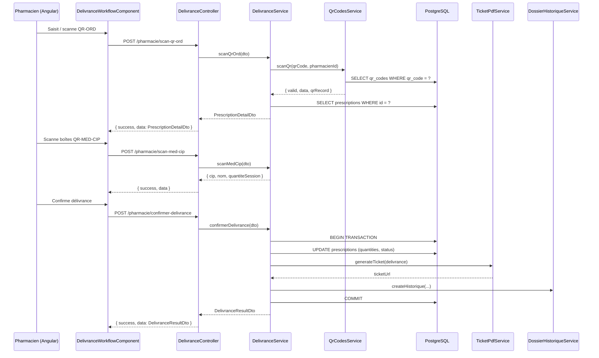
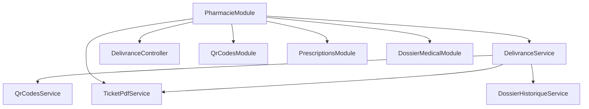

# Design Technique — pharmacie-delivrance-qr

## Overview

Ce document décrit l'architecture et l'implémentation du flux de délivrance en pharmacie via QR-ORD dans MediConnect.

Le flux couvre cinq étapes séquentielles :
1. Scan du QR-ORD et récupération de l'ordonnance
2. Vérification de validité (statut, expiration)
3. Authentification anti-contrefaçon des boîtes via QR-MED-CIP
4. Calcul automatique part CNAM / part patient
5. Confirmation, génération du ticket PDF et mise à jour du dossier patient

Le backend s'appuie sur NestJS + TypeORM + PostgreSQL. Le frontend est Angular 19 avec des standalone components. La communication se fait via REST JSON, toutes les réponses étant wrappées par le `TransformInterceptor` dans `{ success, data, timestamp }`.

---

## Architecture

### Vue d'ensemble



### Modules impliqués



---

## Components and Interfaces

### Backend

#### DelivranceController

Route de base : `POST /api/v1/pharmacie`

| Méthode | Route | DTO | Description |
|---------|-------|-----|-------------|
| POST | `/scan-qr-ord` | `ScanQrOrdDto` | Scan et validation du QR-ORD |
| POST | `/scan-med-cip` | `ScanMedCipDto` | Authentification d'une boîte |
| POST | `/confirmer-delivrance` | `ConfirmerDelivranceDto` | Confirmation et persistance |

Tous les endpoints sont protégés par `JwtAuthGuard` + `RolesGuard` avec le rôle `PHARMACIEN`.

#### DelivranceService

```typescript
interface DelivranceService {
  scanQrOrd(dto: ScanQrOrdDto, pharmacienId: string): Promise<PrescriptionDetailDto>
  scanMedCip(dto: ScanMedCipDto, sessionId: string): Promise<MedCipResultDto>
  confirmerDelivrance(dto: ConfirmerDelivranceDto, pharmacienId: string): Promise<DelivranceResultDto>
  calculerFinancier(medications: MedicationDelivree[]): FinancierDto
}
```

#### TicketPdfService

```typescript
interface TicketPdfService {
  generateTicket(data: TicketData): Promise<string>  // retourne l'URL du fichier
}
```

#### DTOs

**ScanQrOrdDto**
```typescript
class ScanQrOrdDto {
  @IsString() @IsNotEmpty()
  qrCode: string;  // ex: "QR-ORD-XXXX-YYYY"
}
```

**ScanMedCipDto**
```typescript
class ScanMedCipDto {
  @IsString() @IsNotEmpty()
  qrMedCip: string;  // code CIP13 ou contenu du QR-MED-CIP

  @IsString() @IsNotEmpty()
  prescriptionId: string;
}
```

**ConfirmerDelivranceDto**
```typescript
class ConfirmerDelivranceDto {
  @IsString() @IsNotEmpty()
  prescriptionId: string;

  @IsArray()
  medicamentsDelivres: {
    cip: string;
    quantiteDelivree: number;
    prixUnitaire: number;
    tauxCnam: number;  // ex: 0.70
  }[];
}
```

**PrescriptionDetailDto** (réponse)
```typescript
interface PrescriptionDetailDto {
  id: string;
  qrCode: string;
  status: PrescriptionStatus;
  issuedAt: Date;
  expiresAt: Date;
  patient: { id: string; nom: string; prenom: string; nss: string };
  medecin: { id: string; nom: string; prenom: string; rpps: string };
  medications: MedicationDto[];
  notes?: string;
}
```

**DelivranceResultDto** (réponse)
```typescript
interface DelivranceResultDto {
  delivranceId: string;
  prescriptionId: string;
  status: PrescriptionStatus;
  medicamentsDelivres: MedicationDelivreeDto[];
  financier: FinancierDto;
  ticketUrl: string;
  delivreAt: Date;
}
```

**FinancierDto**
```typescript
interface FinancierDto {
  lignes: {
    cip: string;
    nom: string;
    quantite: number;
    prixUnitaire: number;
    montantTotal: number;
    partCnam: number;
    partPatient: number;
  }[];
  totalCnam: number;
  totalPatient: number;
  totalGeneral: number;
}
```

### Frontend

#### DelivranceWorkflowComponent

Route : `/pharmacie/delivrance`

Composant standalone Angular 19 orchestrant les 5 étapes via un signal `currentStep`.

```typescript
type Step = 'scan-qr' | 'verification' | 'scan-boites' | 'recapitulatif' | 'confirmation';

interface WorkflowState {
  currentStep: Step;
  prescription: PrescriptionDetailDto | null;
  boitesScannees: Map<string, number>;  // cip -> quantite
  financier: FinancierDto | null;
  ticketUrl: string | null;
  error: string | null;
}
```

Le composant utilise `HttpClient` directement (pas de service dédié, cohérent avec le pattern existant du `ScannerPharmacieComponent`).

---

## Data Models

### Entités existantes utilisées

**Prescription** (existante, pas de migration nécessaire)
- `medications[].quantityDelivered` : mis à jour lors de la délivrance
- `status` : mis à jour vers `PARTIALLY_USED` ou `FULLY_USED`

**DossierHistorique** (existante)
- Utilisée pour tracer l'événement de délivrance
- `champsModifies` contiendra `{ delivrance: { avant: null, apres: { ... } } }`
- `roleAuteur` = `'PHARMACIEN'`

**QrCode** (existante)
- `scanCount` incrémenté à chaque scan QR-ORD
- `lastScanAt` mis à jour

### Structure de l'entrée DossierHistorique pour une délivrance

```json
{
  "patientId": "uuid-patient",
  "modifieParId": "uuid-pharmacien",
  "roleAuteur": "PHARMACIEN",
  "champsModifies": {
    "delivrance_pharmacie": {
      "avant": null,
      "apres": {
        "prescriptionId": "uuid-prescription",
        "delivranceId": "uuid-delivrance",
        "medicaments": [
          { "cip": "3400930000000", "nom": "Amoxicilline 500mg", "quantiteDelivree": 2 }
        ],
        "pharmacienId": "uuid-pharmacien",
        "delivreAt": "2025-01-15T10:30:00Z"
      }
    }
  },
  "snapshotAvant": { "prescriptionStatus": "ACTIVE" },
  "commentaire": "Délivrance pharmacie — QR-ORD-XXXX-YYYY"
}
```

### Calcul financier

Le calcul est effectué côté backend dans `DelivranceService.calculerFinancier()` :

```
montant_total_ligne = prix_unitaire × quantite_delivree
part_cnam_ligne     = montant_total_ligne × taux_cnam
part_patient_ligne  = montant_total_ligne - part_cnam_ligne

total_cnam    = Σ part_cnam_ligne
total_patient = Σ part_patient_ligne
total_general = Σ montant_total_ligne
```

Le `taux_cnam` et le `prix_unitaire` sont fournis par le frontend dans `ConfirmerDelivranceDto` (le backend ne dispose pas d'un référentiel de prix CNAM — décision de design : les données tarifaires viennent du système de caisse de la pharmacie).

### Stockage du ticket PDF

Les tickets sont sauvegardés dans `uploads/tickets/ticket-{delivranceId}.pdf` et servis via l'endpoint statique existant `/uploads/`.

---

## Correctness Properties

*A property is a characteristic or behavior that should hold true across all valid executions of a system — essentially, a formal statement about what the system should do. Properties serve as the bridge between human-readable specifications and machine-verifiable correctness guarantees.*

### Property 1 : Signature JWT valide requise pour accéder à une ordonnance

*For any* code QR-ORD soumis au `DelivranceService`, si le JWT associé est absent, malformé ou signé avec une clé incorrecte, alors le service doit retourner une erreur 400 et ne jamais retourner de données de prescription.

**Validates: Requirements 1.1, 1.2**

---

### Property 2 : Ordonnance introuvable retourne 404

*For any* code QR-ORD dont le JWT est valide mais dont l'`entityId` ne correspond à aucune `Prescription` en base, le `DelivranceService` doit retourner une erreur 404.

**Validates: Requirements 1.3**

---

### Property 3 : Seules les ordonnances ACTIVE ou PARTIALLY_USED sont délivrables

*For any* `Prescription` dont le statut est `FULLY_USED`, `EXPIRED` ou `REVOKED`, toute tentative de délivrance doit être rejetée avec une erreur 400 et le statut ne doit pas être modifié.

**Validates: Requirements 2.1, 2.2, 2.3, 2.4**

---

### Property 4 : Expiration automatique à la délivrance

*For any* `Prescription` dont `expiresAt` est antérieur à la date courante, le `DelivranceService` doit mettre à jour le statut à `EXPIRED` et retourner une erreur 400, indépendamment du statut stocké en base.

**Validates: Requirements 2.5**

---

### Property 5 : CIP inconnu rejeté

*For any* code QR-MED-CIP dont le CIP13 extrait n'est pas présent dans `Prescription.medications[].cip`, le `DelivranceService` doit retourner une erreur 400 et ne pas incrémenter de compteur.

**Validates: Requirements 3.1, 3.2**

---

### Property 6 : Quantité scannée ne dépasse pas la quantité prescrite

*For any* médicament d'une prescription, la somme `quantityDelivered + quantiteSession` ne doit jamais dépasser `quantity`. Toute tentative de dépassement doit être rejetée avec une erreur 400.

**Validates: Requirements 3.4, 6.1**

---

### Property 7 : Calcul financier cohérent

*For any* liste de médicaments délivrés avec prix unitaire et taux CNAM, les invariants suivants doivent tenir :
- `part_cnam + part_patient = montant_total` pour chaque ligne
- `total_cnam + total_patient = total_general`
- Tous les montants sont ≥ 0

**Validates: Requirements 4.1, 4.2, 4.5**

---

### Property 8 : Mise à jour atomique de la prescription

*For any* délivrance confirmée, soit la transaction réussit entièrement (prescription mise à jour + historique créé + ticket généré), soit elle est entièrement annulée. Il ne doit jamais exister d'état partiel en base.

**Validates: Requirements 6.4, 6.6, 7.2, 7.3**

---

### Property 9 : Statut post-délivrance cohérent avec les quantités

*For any* prescription après une délivrance confirmée :
- Si `quantityDelivered >= quantity` pour tous les médicaments → statut = `FULLY_USED`
- Sinon → statut = `PARTIALLY_USED`

**Validates: Requirements 6.2, 6.3**

---

### Property 10 : Ticket PDF généré pour toute délivrance confirmée

*For any* délivrance confirmée avec succès, un fichier PDF doit exister à l'URL retournée et cette URL doit être non-nulle dans la réponse.

**Validates: Requirements 5.1, 5.2, 5.3**

---

## Error Handling

| Situation | Code HTTP | Message |
|-----------|-----------|---------|
| JWT QR-ORD invalide / absent | 400 | `"Signature QR invalide"` |
| Prescription introuvable | 404 | `"Ordonnance introuvable"` |
| Statut FULLY_USED | 400 | `"Ordonnance déjà entièrement délivrée"` |
| Statut EXPIRED | 400 | `"Ordonnance expirée"` |
| Statut REVOKED | 400 | `"Ordonnance révoquée"` |
| CIP non prescrit | 400 | `"Médicament non prescrit : CIP {valeur}"` |
| Quantité dépassée | 400 | `"Quantité dépassée pour {nom médicament}"` |
| Erreur de persistance | 500 | `"Erreur lors de l'enregistrement de la délivrance"` |
| Rôle insuffisant | 403 | `"Accès refusé"` (géré par RolesGuard) |

Toutes les erreurs sont propagées via les exceptions NestJS standard (`BadRequestException`, `NotFoundException`, `InternalServerErrorException`) et formatées par le `HttpExceptionFilter` existant.

---

## Testing Strategy

### Tests unitaires

Couvrent les cas concrets et les conditions d'erreur :

- `DelivranceService.scanQrOrd` : JWT valide, JWT invalide, prescription introuvable, statuts invalides, expiration automatique
- `DelivranceService.scanMedCip` : CIP valide, CIP inconnu, dépassement de quantité
- `DelivranceService.calculerFinancier` : calcul correct, médicament substituable, liste vide
- `DelivranceService.confirmerDelivrance` : délivrance totale → FULLY_USED, délivrance partielle → PARTIALLY_USED, rollback sur erreur
- `TicketPdfService.generateTicket` : PDF généré, fichier sauvegardé au bon chemin

### Tests property-based

Librairie : **fast-check** (déjà disponible dans l'écosystème Node/TypeScript, cohérent avec le projet).

Configuration : minimum **100 itérations** par propriété.

Chaque test est annoté avec un commentaire de traçabilité :
`// Feature: pharmacie-delivrance-qr, Property {N}: {texte}`

#### Property 1 — Signature JWT valide requise
```
// Feature: pharmacie-delivrance-qr, Property 1: Signature JWT valide requise pour accéder à une ordonnance
fc.property(fc.string(), fc.string(), (invalidJwt, qrCode) => {
  // Pour tout JWT malformé, scanQrOrd doit lever BadRequestException
})
```

#### Property 3 — Seules ACTIVE/PARTIALLY_USED sont délivrables
```
// Feature: pharmacie-delivrance-qr, Property 3: Seules les ordonnances ACTIVE ou PARTIALLY_USED sont délivrables
fc.property(fc.constantFrom('FULLY_USED', 'EXPIRED', 'REVOKED'), (status) => {
  // Pour tout statut invalide, confirmerDelivrance doit lever BadRequestException
})
```

#### Property 5 — CIP inconnu rejeté
```
// Feature: pharmacie-delivrance-qr, Property 5: CIP inconnu rejeté
fc.property(fc.string({ minLength: 13, maxLength: 13 }), (randomCip) => {
  // Pour tout CIP absent de la prescription, scanMedCip doit lever BadRequestException
})
```

#### Property 6 — Quantité scannée ne dépasse pas la quantité prescrite
```
// Feature: pharmacie-delivrance-qr, Property 6: Quantité scannée ne dépasse pas la quantité prescrite
fc.property(fc.nat({ max: 100 }), fc.nat({ max: 100 }), (prescribed, overQuantity) => {
  // quantiteSession = prescribed + overQuantity + 1 doit être rejeté
})
```

#### Property 7 — Calcul financier cohérent
```
// Feature: pharmacie-delivrance-qr, Property 7: Calcul financier cohérent
fc.property(
  fc.array(fc.record({
    quantite: fc.nat({ max: 100 }),
    prixUnitaire: fc.float({ min: 0, max: 1000 }),
    tauxCnam: fc.float({ min: 0, max: 1 })
  }), { minLength: 1 }),
  (lignes) => {
    const result = calculerFinancier(lignes);
    // part_cnam + part_patient === montant_total pour chaque ligne
    // total_cnam + total_patient === total_general
    // tous les montants >= 0
  }
)
```

#### Property 8 — Mise à jour atomique
```
// Feature: pharmacie-delivrance-qr, Property 8: Mise à jour atomique de la prescription
// Test d'intégration : simuler une erreur lors de la création DossierHistorique
// et vérifier que la prescription n'est pas modifiée en base
```

#### Property 9 — Statut post-délivrance cohérent
```
// Feature: pharmacie-delivrance-qr, Property 9: Statut post-délivrance cohérent avec les quantités
fc.property(
  fc.array(fc.record({
    quantity: fc.nat({ min: 1, max: 10 }),
    quantityDelivered: fc.nat({ max: 10 })
  }), { minLength: 1 }),
  (meds) => {
    const allFull = meds.every(m => m.quantityDelivered >= m.quantity);
    const expectedStatus = allFull ? 'FULLY_USED' : 'PARTIALLY_USED';
    // computeStatus(meds) === expectedStatus
  }
)
```

### Approche duale

Les tests unitaires et property-based sont complémentaires :
- Les tests unitaires vérifient des exemples concrets (cas nominaux, messages d'erreur exacts, format du PDF)
- Les tests property-based vérifient les invariants sur un large espace d'entrées générées aléatoirement
