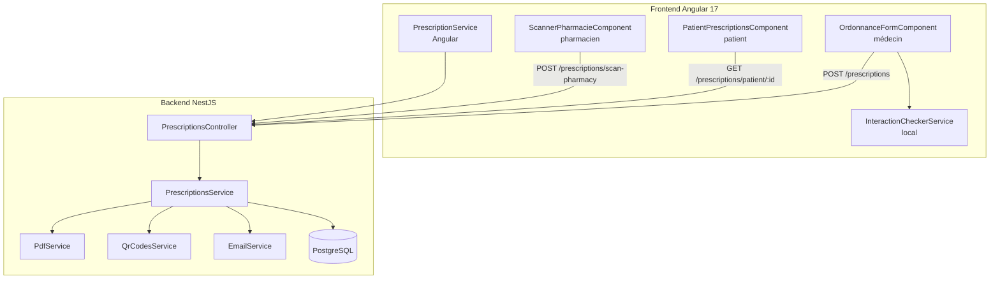
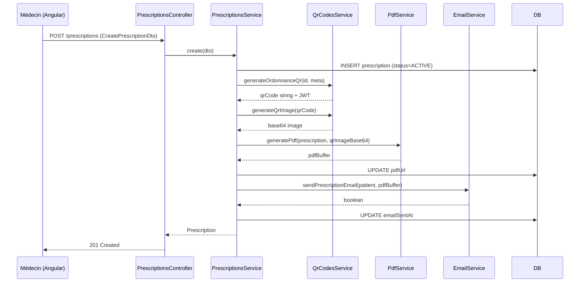

# Design Document — Prescription Médicale (Sprint 3)

## Overview

La feature **prescription-medicale** enrichit MediConnect d'un cycle complet de gestion des ordonnances :
saisie par le médecin avec vérification des interactions médicamenteuses, génération d'un PDF signé
embarquant un QR-ORD JWT, envoi email sécurisé au patient, consultation/téléchargement côté patient,
et dispensation en pharmacie via scan du QR-ORD.

Le module s'appuie sur les services existants (`QrCodesService`, `EmailService`) et enrichit
l'entité `Prescription` déjà partiellement implémentée. Le backend est NestJS + TypeORM/PostgreSQL ;
le frontend est Angular 17 avec standalone components.

---

## Architecture



### Flux principal de création d'ordonnance



---

## Components and Interfaces

### Backend

#### PrescriptionsController — nouveaux endpoints

| Méthode | Route | Rôle requis | Description |
|---------|-------|-------------|-------------|
| POST | `/prescriptions` | MEDECIN_* | Créer une ordonnance |
| GET | `/prescriptions/patient/:patientId` | MEDECIN_* / PATIENT | Ordonnances d'un patient |
| GET | `/prescriptions/:id` | Tous authentifiés | Détail d'une ordonnance |
| GET | `/prescriptions/:id/pdf` | MEDECIN_* / PATIENT | Télécharger le PDF |
| POST | `/prescriptions/scan-pharmacy` | PHARMACIEN_* | Scanner QR-ORD |
| POST | `/prescriptions/:id/sign` | MEDECIN_* | Signer électroniquement |
| PATCH | `/prescriptions/:id/revoke` | MEDECIN_* | Révoquer une ordonnance |

#### PdfService (nouveau)

```typescript
interface PdfService {
  generatePrescriptionPdf(
    prescription: Prescription,
    doctor: User & { profile: MedecinProfile },
    patient: Patient,
    qrImageBase64: string,
  ): Promise<Buffer>;
}
```

Implémentation avec **pdfmake** (côté Node.js). Le PDF est généré en mémoire (Buffer),
stocké sur disque ou S3 (selon config), et l'URL est persistée dans `pdfUrl`.

#### InteractionCheckerService (nouveau, backend)

```typescript
interface DrugInteraction {
  drug1Cip: string;
  drug2Cip: string;
  severity: 'mineure' | 'moderee' | 'severe';
  description: string;
}

interface InteractionCheckerService {
  checkInteractions(medications: MedicationDto[]): DrugInteraction[];
}
```

Basé sur une liste statique JSON embarquée dans le module. Pas d'appel API externe.

### Frontend Angular 17

#### OrdonnanceFormComponent (médecin)

Standalone component dans `frontend/src/app/modules/medecin/pages/prescriptions/`.

Responsabilités :
- Formulaire réactif (ReactiveFormsModule) avec `FormArray` pour les médicaments
- Appel à `PrescriptionService.checkInteractions()` à chaque ajout/modification de médicament
- Affichage des alertes d'interaction (non-bloquant pour `modérée`, bloquant pour `sévère`)
- Soumission vers `POST /prescriptions`

#### PatientPrescriptionsComponent (patient) — enrichissement

Composant existant dans `frontend/src/app/modules/patient/pages/prescriptions/`.

Responsabilités :
- Liste paginée des ordonnances triées par date décroissante
- Affichage du statut avec badge coloré
- Bouton "Télécharger PDF" (désactivé si `pdfUrl` absent)
- Appel `GET /prescriptions/patient/:id`

#### ScannerPharmacieComponent (pharmacien)

Nouveau composant dans `frontend/src/app/modules/pharmacie/pages/scanner/`.

Responsabilités :
- Champ de saisie du QR-ORD (scan ou saisie manuelle)
- Affichage des détails de l'ordonnance récupérée
- Formulaire de dispensation (quantités délivrées par médicament)
- Soumission vers `POST /prescriptions/scan-pharmacy`

#### PrescriptionService (Angular)

Service Angular dans `frontend/src/app/core/services/prescription.service.ts`.

```typescript
interface PrescriptionService {
  createPrescription(dto: CreatePrescriptionDto): Observable<Prescription>;
  getPatientPrescriptions(patientId: string): Observable<Prescription[]>;
  getPrescription(id: string): Observable<Prescription>;
  downloadPdf(id: string): Observable<Blob>;
  scanPharmacy(qrCode: string, dispensed: Record<string, number>): Observable<Prescription>;
  checkInteractions(medications: MedicationDto[]): Observable<DrugInteraction[]>;
}
```

---

## Data Models

### Entité `Prescription` enrichie

```typescript
@Entity('prescriptions')
export class Prescription {
  @PrimaryGeneratedColumn('uuid') id: string;

  @Column({ name: 'patient_id' }) patientId: string;
  @ManyToOne(() => Patient) @JoinColumn({ name: 'patient_id' }) patient: Patient;

  @Column({ name: 'doctor_id' }) doctorId: string;
  @ManyToOne(() => User) @JoinColumn({ name: 'doctor_id' }) doctor: User;

  @Column({ name: 'qr_code', unique: true }) qrCode: string;
  @Column({ name: 'qr_jwt', type: 'text' }) qrJwt: string;

  @Column({ type: 'enum', enum: PrescriptionStatus, default: PrescriptionStatus.ACTIVE })
  status: PrescriptionStatus;

  @Column({ name: 'medications', type: 'jsonb' })
  medications: MedicationEntry[];

  @Column({ name: 'appointment_id', nullable: true }) appointmentId: string;
  @Column({ name: 'pdf_url', nullable: true }) pdfUrl: string;

  // NOUVEAU
  @Column({ name: 'email_sent_at', nullable: true }) emailSentAt: Date;
  @Column({ name: 'notes', type: 'text', nullable: true }) notes: string;

  @Column({ name: 'issued_at', type: 'timestamp' }) issuedAt: Date;
  @Column({ name: 'expires_at', type: 'timestamp' }) expiresAt: Date;
  @Column({ name: 'signed_at', nullable: true }) signedAt: Date;
  @Column({ name: 'electronic_signature', nullable: true, type: 'text' }) electronicSignature: string;

  @CreateDateColumn({ name: 'created_at' }) createdAt: Date;
  @UpdateDateColumn({ name: 'updated_at' }) updatedAt: Date;
}
```

Champs ajoutés par rapport à l'existant : `emailSentAt`, `notes`.

### Type `MedicationEntry`

```typescript
interface MedicationEntry {
  cip: string;               // Code Identifiant de Présentation
  name: string;              // Nom commercial
  dosage: string;            // Ex: "500mg"
  posology: string;          // Ex: "1 comprimé matin et soir"
  durationDays: number;      // Durée en jours
  quantity: number;          // Quantité prescrite
  isSubstitutable: boolean;  // Générique autorisé
  quantityDelivered?: number; // Mis à jour par le pharmacien
}
```

### DTOs Backend

```typescript
// CreateMedicationDto
class CreateMedicationDto {
  @IsString() @IsNotEmpty() cip: string;
  @IsString() @IsNotEmpty() name: string;
  @IsString() @IsNotEmpty() dosage: string;
  @IsString() @IsNotEmpty() posology: string;
  @IsInt() @Min(1) durationDays: number;
  @IsInt() @Min(1) quantity: number;
  @IsBoolean() isSubstitutable: boolean;
}

// CreatePrescriptionDto
class CreatePrescriptionDto {
  @IsUUID() patientId: string;
  @IsUUID() doctorId: string;
  @IsOptional() @IsUUID() appointmentId?: string;
  @IsArray() @ValidateNested({ each: true }) @ArrayMinSize(1)
  @Type(() => CreateMedicationDto)
  medications: CreateMedicationDto[];
  @IsOptional() @IsString() notes?: string;
  // Métadonnées pour le QR (résolues côté service)
  patientName?: string;
  patientNss?: string;
  medecinRpps?: string;
  medecinName?: string;
}

// ScanPharmacyDto
class ScanPharmacyDto {
  @IsString() @IsNotEmpty() qrCode: string;
  @IsObject() dispensedQuantities: Record<string, number>;
}
```

### Modèle Angular `Prescription`

```typescript
export interface Prescription {
  id: string;
  patientId: string;
  doctorId: string;
  qrCode: string;
  status: PrescriptionStatus;
  medications: MedicationEntry[];
  appointmentId?: string;
  pdfUrl?: string;
  emailSentAt?: string;
  notes?: string;
  issuedAt: string;
  expiresAt: string;
  signedAt?: string;
  createdAt: string;
}

export type PrescriptionStatus =
  | 'ACTIVE' | 'PARTIALLY_USED' | 'FULLY_USED' | 'EXPIRED' | 'REVOKED';
```

### Liste statique des interactions médicamenteuses

Fichier JSON embarqué : `backend/src/modules/prescriptions/data/drug-interactions.json`

```json
[
  {
    "drug1Cip": "3400935418487",
    "drug2Cip": "3400936081697",
    "severity": "severe",
    "description": "Risque de syndrome sérotoninergique"
  }
]
```

La vérification est O(n²) sur les paires de médicaments de l'ordonnance, acceptable
pour des ordonnances de taille raisonnable (< 20 médicaments).


---

## Correctness Properties

*A property is a characteristic or behavior that should hold true across all valid executions of a system — essentially, a formal statement about what the system should do. Properties serve as the bridge between human-readable specifications and machine-verifiable correctness guarantees.*

### Property 1 : Prescription créée avec statut ACTIVE et expiration à 90 jours

*For any* `CreatePrescriptionDto` valide contenant au moins un médicament, la prescription créée par `PrescriptionsService.create()` doit avoir le statut `ACTIVE` et une date d'expiration égale à `issuedAt + 90 jours`.

**Validates: Requirements 1.1**

---

### Property 2 : Interactions médicamenteuses avec sévérité valide

*For any* liste de médicaments (au moins 2), toutes les interactions retournées par `InteractionCheckerService.checkInteractions()` doivent avoir un champ `severity` appartenant à `{ 'mineure', 'moderee', 'severe' }`.

**Validates: Requirements 1.3**

---

### Property 3 : Format du QR-ORD

*For any* prescription créée avec succès, le champ `qrCode` doit correspondre au pattern `QR-ORD-[A-Z0-9]+-[A-Z0-9]+`.

**Validates: Requirements 1.7**

---

### Property 4 : PDF généré non-vide et persisté

*For any* prescription avec statut `ACTIVE`, `PdfService.generatePrescriptionPdf()` doit retourner un `Buffer` non-vide dont les 4 premiers octets correspondent à la signature PDF (`%PDF`), et `pdfUrl` doit être défini après la création.

**Validates: Requirements 2.1, 2.3**

---

### Property 5 : Email envoyé avec les bonnes métadonnées

*For any* prescription créée avec un patient ayant une adresse email valide, `EmailService` doit être appelé avec le destinataire correspondant à l'email du patient et un contenu incluant le nom du médecin et la date d'émission.

**Validates: Requirements 3.1, 3.2**

---

### Property 6 : `emailSentAt` enregistré après envoi réussi

*For any* prescription dont l'email a été envoyé avec succès, le champ `emailSentAt` de l'entité `Prescription` doit être une date non-nulle postérieure à `issuedAt`.

**Validates: Requirements 3.5**

---

### Property 7 : Liste des ordonnances triée par date décroissante

*For any* patient ayant plusieurs prescriptions, `PrescriptionsService.findByPatient()` doit retourner une liste où `prescriptions[i].createdAt >= prescriptions[i+1].createdAt` pour tout `i`.

**Validates: Requirements 4.1, 4.2**

---

### Property 8 : Isolation des données patient

*For any* appel à `findByPatient(patientId)`, toutes les prescriptions retournées doivent avoir `patientId` égal au paramètre fourni — aucune prescription d'un autre patient ne doit apparaître.

**Validates: Requirements 4.5**

---

### Property 9 : Transition de statut après dispensation

*For any* prescription `ACTIVE` et *for any* ensemble de quantités dispensées, après `scanAtPharmacy()` :
- si `∀ médicament : quantityDelivered >= quantity` → statut = `FULLY_USED`
- sinon → statut = `PARTIALLY_USED`

**Validates: Requirements 5.2, 5.3, 5.4**

---

### Property 10 : Rejet des JWT invalides ou expirés

*For any* QR-ORD dont le JWT a une signature invalide ou est expiré, `QrCodesService.scanQr()` doit lever une `BadRequestException` sans modifier l'état de la prescription.

**Validates: Requirements 5.9**

---

### Property 11 : Round-trip sérialisation des prescriptions

*For any* `CreatePrescriptionDto` valide, créer une prescription puis la récupérer via `findOne()` doit produire un objet dont tous les champs métier (`medications`, `patientId`, `doctorId`, `status`, `issuedAt`, `expiresAt`) sont équivalents aux valeurs soumises.

**Validates: Requirements 6.3**

---

## Error Handling

| Situation | Code HTTP | Message |
|-----------|-----------|---------|
| Aucun médicament dans le DTO | 400 | `"Au moins un médicament est requis"` |
| Champ obligatoire manquant | 400 | Liste des champs manquants (class-validator) |
| Prescription introuvable | 404 | `"Prescription introuvable"` |
| Accès à la prescription d'un autre patient | 403 | `"Accès refusé"` |
| Ordonnance expirée (scan pharmacie) | 400 | `"Ordonnance expirée"` |
| Ordonnance déjà délivrée (scan pharmacie) | 400 | `"Ordonnance déjà délivrée"` |
| Ordonnance révoquée (scan pharmacie) | 400 | `"Ordonnance révoquée"` |
| QR-ORD introuvable | 404 | `"Ordonnance introuvable"` |
| Signature JWT invalide | 400 | `"Signature QR invalide"` |
| Erreur génération PDF | 500 | `"Erreur lors de la génération du PDF"` |
| Email patient absent/invalide | — | Logger uniquement, pas d'exception (non-bloquant) |
| SMTP indisponible | — | Logger + retourner `false`, pas d'exception |

### Stratégie de non-blocage pour l'email

L'envoi email est déclenché en fire-and-forget après la persistance de la prescription.
Si `EmailService.sendPrescriptionEmail()` retourne `false`, la prescription est quand même
retournée au client avec `emailSentAt = null`. Le médecin peut renvoyer manuellement.

---

## Testing Strategy

### Approche duale : tests unitaires + tests basés sur les propriétés

Les deux types de tests sont complémentaires et tous deux requis :
- **Tests unitaires** : cas concrets, edge cases, intégration entre composants
- **Tests de propriétés** : validation universelle sur des entrées générées aléatoirement

### Tests unitaires (Jest — NestJS)

Focalisés sur :
- Cas d'erreur spécifiques (edge cases des requirements 1.6, 2.4, 3.3, 3.4, 4.6, 5.5–5.8, 6.4)
- Intégration `PrescriptionsService` ↔ `QrCodesService` (mock)
- Intégration `PrescriptionsService` ↔ `EmailService` (mock)
- Intégration `PrescriptionsService` ↔ `PdfService` (mock)
- Validation des DTOs via `class-validator`

Exemples de tests unitaires :
```typescript
it('should throw 400 when medications array is empty')
it('should return 403 when patient accesses another patient prescription')
it('should return 400 with "Ordonnance expirée" for EXPIRED prescription scan')
it('should not throw when patient email is missing')
it('should return false (not throw) when SMTP is unavailable')
```

### Tests de propriétés (fast-check — TypeScript)

Bibliothèque : **fast-check** (compatible TypeScript/Jest, 100+ itérations par propriété).

Configuration minimale : `fc.assert(fc.property(...), { numRuns: 100 })`.

Chaque test de propriété est tagué avec un commentaire de référence :
`// Feature: prescription-medicale, Property N: <texte>`

```typescript
// Feature: prescription-medicale, Property 1: Prescription créée avec statut ACTIVE et expiration 90j
fc.assert(fc.property(
  validCreatePrescriptionDtoArb,
  async (dto) => {
    const result = await service.create(dto);
    expect(result.status).toBe(PrescriptionStatus.ACTIVE);
    const diff = differenceInDays(result.expiresAt, result.issuedAt);
    expect(diff).toBe(90);
  }
), { numRuns: 100 });

// Feature: prescription-medicale, Property 2: Interactions avec sévérité valide
fc.assert(fc.property(
  fc.array(medicationArb, { minLength: 2 }),
  (meds) => {
    const interactions = checker.checkInteractions(meds);
    interactions.forEach(i =>
      expect(['mineure', 'moderee', 'severe']).toContain(i.severity)
    );
  }
), { numRuns: 100 });

// Feature: prescription-medicale, Property 9: Transition de statut après dispensation
fc.assert(fc.property(
  activePrescriptionArb,
  dispensedQuantitiesArb,
  async (prescription, dispensed) => {
    const result = await service.scanAtPharmacy(prescription.qrCode, dispensed);
    const allDone = result.medications.every(m => m.quantityDelivered >= m.quantity);
    expect(result.status).toBe(
      allDone ? PrescriptionStatus.FULLY_USED : PrescriptionStatus.PARTIALLY_USED
    );
  }
), { numRuns: 100 });

// Feature: prescription-medicale, Property 11: Round-trip sérialisation
fc.assert(fc.property(
  validCreatePrescriptionDtoArb,
  async (dto) => {
    const created = await service.create(dto);
    const fetched = await service.findOne(created.id);
    expect(fetched.patientId).toBe(dto.patientId);
    expect(fetched.medications).toEqual(expect.arrayContaining(
      dto.medications.map(m => expect.objectContaining({ cip: m.cip, quantity: m.quantity }))
    ));
  }
), { numRuns: 100 });
```

### Tests Angular (Jest + Angular Testing Library)

- `OrdonnanceFormComponent` : vérifier que le formulaire est invalide sans médicament
- `PatientPrescriptionsComponent` : vérifier l'affichage du badge de statut et du bouton désactivé
- `ScannerPharmacieComponent` : vérifier l'affichage des détails après scan valide
- `PrescriptionService` (Angular) : vérifier les appels HTTP avec `HttpClientTestingModule`
